## Visión general

Organizamos el almacén con el enfoque **medallion**: los datos pasan por tres niveles de calidad (bronze, silver y
gold), cada nivel solo lee del anterior y cada uno garantiza algo que el anterior no garantiza. Las tres capas que
pide la entrega (staging, DW y DataMart) se acomodan en esos niveles así:

| Nivel medallion | Capa de la entrega | Dónde vive | Prefijo | Qué garantiza | Quién la lee |
|---|---|---|---|---|---|
| **Bronze** | Staging | Dataset `misoginia_staging` | `stg_` | Copia fiel de cada archivo o descarga, sin cambios. La descripción de la tabla dice de qué fuente (F1–F19) y en qué fecha se cargó. | Solo silver |
| **Silver** | Preparación | En E1, notebooks del equipo con archivos Parquet; en la entrega de preparación, dataset `misoginia_silver` | `slv_` | Datos limpios, con tipos correctos, sin duplicados y con las llaves comunes: `cve_ent`, fecha al primer día del mes, `spotify_id` y `clave_cancion`. | Solo gold |
| **Gold** | DW | Dataset `misoginia_dw` | `dim_`, `fact_` | Esquema estrella: dos hechos y cinco dimensiones, cada una ligada a una pregunta de E0. | El DataMart |
| **Gold** | DataMart | Dataset `misoginia_mart` | `p1_` a `p4_` | Una o más vistas por pregunta, con lógica OLAP. | El equipo, el stakeholder y, más adelante, Looker Studio |

Los datasets de BigQuery se crean en la misma ubicación, **US**, porque BigQuery no permite consultas entre
datasets de regiones distintas. La entrega pide tres datasets y no pide ETL, así que silver no tiene dataset en
E1: se diseña aquí y se materializa en la entrega de preparación, también en US.

```{mermaid}
%%{init: {'theme': 'base', 'themeVariables': {'primaryColor': '#eef3fb', 'primaryTextColor': '#1b1f24', 'primaryBorderColor': '#4a6fa5', 'lineColor': '#4a6fa5', 'clusterBkg': '#fafafa', 'clusterBorder': '#9aa5b1', 'fontSize': '13px'}}}%%
flowchart LR
    subgraph BR["BRONZE · misoginia_staging"]
        direction TB
        b1["Charts<br/>stg_kworb_mx_semanal<br/>stg_kaggle_charts_mx (validación)"]
        b5["Clasificador y género<br/>stg_misongyny<br/>stg_musicbrainz_tags"]
        b2["Google Trends<br/>stg_trends_*"]
        b4["Contexto<br/>stg_conapo_poblacion · stg_endutih_usuarios<br/>stg_endireh_* · stg_censo_iter<br/>stg_coneval_pobreza · stg_mexico_evalua<br/>stg_naturalearth_mx"]
        b3["Violencia<br/>stg_sesnsp_delitos · stg_sesnsp_victimas<br/>stg_rnpdno"]
    end
    L["LRCLIB y Last.fm<br/>se consultan sin guardar"]
    subgraph SV["SILVER · preparación"]
        direction TB
        s1["slv_charts_mes"]
        s2["slv_canciones"]
        s3["slv_pesos_trends"]
        s5["slv_cat_entidades<br/>slv_contexto_entidad_anio"]
        s4["slv_violencia_mes<br/>slv_tipos_violencia"]
    end
    subgraph GD["GOLD · misoginia_dw y misoginia_mart"]
        direction TB
        g1["fact_consumo_musical"]
        g3["dim_fecha · dim_entidad · dim_cancion<br/>dim_tipo_violencia · dim_contexto_entidad"]
        g2["fact_violencia"]
        g4["DataMart<br/>7 vistas p1_ a p4_"]
    end
    b1 --> s1
    b5 --> s2
    L -.-> s2
    b2 --> s3
    b4 --> s5
    b3 --> s4
    s1 --> g1
    s3 --> g1
    s2 --> g3
    s5 --> g3
    s4 --> g3
    s4 --> g2
    g1 --> g4
    g3 --> g4
    g2 --> g4
    style BR fill:#fbf1e6,stroke:#a8692b,color:#1b1f24
    style SV fill:#f1f3f5,stroke:#6c757d,color:#1b1f24
    style GD fill:#fff8dc,stroke:#b8860b,color:#1b1f24
    classDef bronze fill:#f6e3cf,stroke:#a8692b,color:#1b1f24
    classDef silver fill:#e3e6ea,stroke:#6c757d,color:#1b1f24
    classDef gold fill:#ffeeb0,stroke:#b8860b,color:#1b1f24
    classDef fuera fill:#ffffff,stroke:#7a8699,color:#1b1f24,stroke-dasharray: 4 3
    class b1,b2,b3,b4,b5 bronze
    class s1,s2,s3,s4,s5 silver
    class g1,g2,g3,g4 gold
    class L fuera
```

## Bronze · staging

Contiene una tabla por archivo o descarga, con los datos tal como vienen: mismos nombres de columna, sin limpiar ni
transformar. Nada se corrige en esta capa; si una fuente cambia, se carga una tabla nueva. Basta una muestra de
cada fuente, porque la carga desde la consola de BigQuery admite archivos de hasta unos 100 MB.

| Tabla de staging | Fuente, archivo y tamaño | Observación |
|---|---|---|
| `stg_sesnsp_delitos` | [F1](fuentes/f01_sesnsp.qmd): Estatal-Delitos-2015-2025_ago2026.csv, 4.6 MB | Archivo completo. |
| `stg_sesnsp_victimas` | [F1](fuentes/f01_sesnsp.qmd): Estatal-Víctimas-2015-2025_ago2026.csv, 12.4 MB | Archivo completo. |
| `stg_endireh_2021_tb_sec_iv` | [F2](fuentes/f02_endireh.qmd): TB_SEC_IV.csv, 32 MB | Una tabla por sección que se use; la muestra es la sección IV. |
| `stg_conapo_poblacion` | [F3](fuentes/f03_conapo.qmd): 00_Pob_Mitad_1950_2070.csv, 45.2 MB | Archivo completo. |
| `stg_kworb_mx_semanal` | [F4](fuentes/f04_kworb.qmd): historial semanal de México de cada canción, de 5,146 páginas, más la lista `mx_weekly_totals` | Una fila por canción y semana con la celda tal como aparece (`posición (streams)`) y la fecha de descarga. La muestra son las 300 canciones con más streams. |
| `stg_kworb_catalogo_canciones` | [F4](fuentes/f04_kworb.qmd): catálogo recuperado de `mx_weekly_totals` el 10-10-2026 | Una fila por `track_id`, con artista, título, enlace de origen y fecha de consulta. La extracción de 300 canciones quedó validada en Colab; la carga en BigQuery requiere verificar un posible encabezado adicional. |
| `stg_kaggle_charts_mx` | [F5](fuentes/f05_kaggle.qmd): charts.csv, filas de México, 60.8 MB | Solo para validar a Kworb en 2017–2021. El archivo global de 3.48 GB excede el límite; se carga la parte de México. |
| `stg_trends_<tema>_<anio>` | [F11](fuentes/f11_google_trends.qmd): un CSV por tema (o término) y año, < 1 KB cada uno | Una tabla por descarga, sin modificar. La muestra son las descargas de 2021 de la [página de pivote](pivote.qmd#evidencia-trends), en `datos/trends/`. |
| `stg_rnpdno` | [F13](fuentes/f13_rnpdno.qmd): versión pública del RNPDNO, 13 MB | Sin las columnas de nombres, por ser datos personales. |
| `stg_censo_iter` | [F14](fuentes/f14_censo_iter.qmd): conjunto_de_datos_iter_00CSV20.csv, 150 MB | Excede el límite de la consola; se carga desde Cloud Storage o una muestra de filas por entidad. |
| `stg_coneval_pobreza` | [F15](fuentes/f15_coneval.qmd): anexo estadístico entidades 2022, 318 KB | BigQuery no carga Excel; se carga cada hoja como CSV. |
| `stg_endutih_usuarios` | [F16](fuentes/f16_endutih.qmd): tic_2024_usuarios, 156 MB | Viene en DBF; se exporta a CSV para cargarlo. |
| `stg_mexico_evalua` | [F17](fuentes/f17_mexico_evalua.qmd): hallazgos 2023, < 1 MB | Valores por entidad tomados del reporte en PDF. |
| `stg_naturalearth_mx` | [F18](fuentes/f18_natural_earth.qmd): ne_10m_admin_1_states_provinces, < 1 MB | Registros de México con su geometría en texto. |
| `stg_misongyny` | [F6](fuentes/f06_misongyny.qmd): TRAIN y TEST de las tareas 1 y 2, < 1 MB | Etiquetas de referencia para validar el clasificador. |
| `stg_musicbrainz_tags` | [F8](fuentes/f08_musicbrainz.qmd): respuestas de la API para los artistas de la muestra, < 1 MB | JSON por artista con sus etiquetas, tal como lo devuelve la API. |
: {tbl-colwidths="[28,36,36]"}

No entran a staging:

- **Letras de LRCLIB (F7):** tienen derechos de autor. Silver las consulta en memoria para clasificarlas y solo
  guarda el resultado.
- **Charts por ciudad de Spotify Charts (F9):** sus términos de uso prohíben extraer su contenido.
- **Mapa de Salguero (F10):** el mapa no permite exportar datos, así que no hay archivo que cargar. Se queda en el
  catálogo como referencia del subregistro.
- **Last.fm (F19):** se consulta solo para los artistas sin etiquetas en MusicBrainz.

## Silver · preparación

Silver toma las tablas de bronze y las deja listas para el esquema estrella. La preparación completa corresponde a
la siguiente entrega; aquí quedan definidas sus tablas y las reglas que deben cumplir antes de pasar a gold.

| Tabla silver | Grano | Entradas | Qué se hace | Alimenta en gold |
|---|---|---|---|---|
| `slv_cat_entidades` | Una fila por entidad y forma de escribirla | Nombres de SESNSP, CONAPO, ENDIREH, RNPDNO, Trends (español e inglés) y Natural Earth | Catálogo de equivalencias de cada nombre a la clave INEGI, con su región del Banco de México | `dim_entidad` |
| `slv_charts_mes` | Canción y mes, nacional | `stg_kworb_mx_semanal`; `stg_kaggle_charts_mx` para validar | Separar posición y streams de cada celda; repartir cada semana entre meses según sus días; contar semanas en el chart y mejor posición | `fact_consumo_musical`, antes del reparto por entidad |
| `slv_canciones` | Canción | `slv_charts_mes`, `stg_kworb_catalogo_canciones`, `stg_musicbrainz_tags`, Last.fm, letras de LRCLIB, `stg_misongyny` | Clave normalizada; género y país validados; etiquetas crudas; macrogénero agrupando las etiquetas más frecuentes; etiqueta directa de MiSonGyny o del clasificador | `dim_cancion` y el `tipo_violencia_key` del hecho |
| `slv_pesos_trends` | Tema, entidad y año | `stg_trends_*`, `slv_cat_entidades`, `slv_contexto_entidad_anio` | Llevar nombres a clave INEGI; escalar por usuarios de internet; elegir el nivel de respaldo ([fórmula](estrella.qmd#estimacion)) | `peso_entidad`, `interes_busqueda`, `origen_peso` |
| `slv_violencia_mes` | Entidad, delito o registro y mes | `stg_sesnsp_delitos`, `stg_sesnsp_victimas`, `stg_rnpdno` | Pasar el SESNSP de una columna por mes a una fila por mes; víctimas mujeres, mujeres menores de edad y hombres; contar mujeres desaparecidas por mes de desaparición y estatus | `fact_violencia` |
| `slv_tipos_violencia` | Delito o categoría | Delitos del SESNSP, categorías del clasificador, RNPDNO | Mapeo a la LGAMVLV ([tabla de mapeo](estrella.qmd#mapeo-inicial-a-la-lgamvlv)) | `dim_tipo_violencia` |

`dim_fecha` no pasa por silver: es un calendario que se genera directamente en gold.

### Reglas para pasar de silver a gold

Una tabla silver solo se carga a gold si cumple estas reglas. Las que miden cobertura no detienen la carga, pero
su valor se reporta junto con los resultados.

| Regla | Se revisa en |
|---|---|
| Las 32 entidades tienen clave INEGI en cada fuente; ningún nombre se queda sin clave. | `slv_cat_entidades` |
| No hay filas repetidas en el grano de cada tabla. | Todas |
| Las fechas son el primer día del mes y caen dentro de la ventana. | `slv_charts_mes`, `slv_violencia_mes` |
| Los streams semanales de Kworb coinciden con la suma de los 7 días de Kaggle en las semanas de 2017–2021 donde las dos fuentes tienen la canción. | `slv_charts_mes` |
| Cada semana del chart tiene sus posiciones completas; las semanas incompletas se reportan. | `slv_charts_mes` |
| Los pesos de cada canción y periodo suman 1, y la suma de los streams estimados de las 32 entidades es igual al streams nacional. | `slv_pesos_trends` |
| Los conteos no son negativos y las víctimas mujeres no superan a las víctimas totales. | `slv_violencia_mes` |
| Ninguna letra de canción ni nombre de persona sale de silver. | `slv_canciones`, `slv_violencia_mes` |
| Cobertura: parte del consumo con letra clasificada, parte etiquetada por MiSonGyny y parte con peso del propio artista. | `slv_canciones`, `slv_pesos_trends` |

## Gold · DW

Contiene el esquema estrella descrito en [Esquema estrella](estrella.qmd): `fact_consumo_musical` y
`fact_violencia`, con las dimensiones compartidas `dim_fecha`, `dim_entidad`, `dim_tipo_violencia` y
`dim_contexto_entidad`, más `dim_cancion`. Las tablas se crean con el DDL de [`sql/ddl_dw.sql`](sql/ddl_dw.sql) y
quedan vacías en esta entrega.

### Linaje: de cada tabla gold a su fuente {#linaje}

| Tabla gold | Silver | Bronze | Fuentes |
|---|---|---|---|
| `dim_fecha` | — (calendario generado) | — | — |
| `dim_entidad` | `slv_cat_entidades` | `stg_naturalearth_mx` y los nombres de todas las tablas | F18 y todas las que traen entidad |
| `dim_cancion` | `slv_canciones` | `stg_kworb_mx_semanal`, `stg_kworb_catalogo_canciones`, `stg_musicbrainz_tags`, `stg_misongyny` | F4, F6, F7, F8, F19 |
| `dim_tipo_violencia` | `slv_tipos_violencia` | `stg_sesnsp_delitos`, `stg_sesnsp_victimas`, `stg_rnpdno`, `stg_misongyny` | F1, F6, F13 |
| `dim_contexto_entidad` | `slv_contexto_entidad_anio` | `stg_conapo_poblacion`, `stg_endutih_usuarios`, `stg_censo_iter`, `stg_coneval_pobreza`, `stg_mexico_evalua`, `stg_endireh_*` | F2, F3, F14, F15, F16, F17 |
| `fact_consumo_musical` | `slv_charts_mes`, `slv_pesos_trends` | `stg_kworb_mx_semanal`, `stg_trends_*` | F4, F11; F3 y F16 para el peso; F5 valida |
| `fact_violencia` | `slv_violencia_mes` | `stg_sesnsp_delitos`, `stg_sesnsp_victimas`, `stg_rnpdno` | F1, F13 |

Cada fila de hechos guarda además su fuente en la columna `fuente`, así que el linaje se puede seguir también
fila por fila.

## Gold · DataMart

Contiene vistas construidas sobre el esquema estrella. Las vistas son válidas aunque las tablas todavía estén
vacías.

| Vista | Pregunta | Operación OLAP |
|---|---|---|
| `p1_proporcion_misogina_genero` | P1 | `GROUP BY ROLLUP` por año, macrogénero y género, con `GROUPING` para marcar los subtotales; reporta qué parte está etiquetada por personas (MiSonGyny). |
| `p1_proporcion_misogina_entidad` | P1 | `RANK` de entidades por año y diferencia contra el promedio estatal con `AVG() OVER`. |
| `p2_serie_mensual_nacional` | P2 | Serie mensual de proporción misógina y tasas por 100 mil mujeres por tipo de violencia. |
| `p2_correlacion_nacional` | P2 | `CORR` por tipo de violencia, con el número de meses. |
| `p2_panel_entidad_anio` | P2 | `CORR` como función de ventana: entre entidades de cada año y con todos los años juntos; variables de control, tasa de víctimas hombres y parte de víctimas menores de edad. |
| `p3_tendencia_tipo_violencia` | P3 | Participación mensual con `SUM() OVER`, media móvil de 12 meses y cambio anual con marcos `RANGE`, que cuentan meses de calendario aunque falte alguno. |
| `p4_tipos_musica_vs_oficial` | P4 | `UNPIVOT` de las prevalencias de la ENDIREH y `RANK` de cada tipo en la música, el SESNSP y la ENDIREH. |

Las vistas siguen tres reglas:

- **El consumo nacional es la suma de las 32 entidades.** El reparto conserva el total, así que no hay una fila
  "Nacional" que pueda contarse dos veces.
- **La proporción misógina solo cuenta canciones clasificadas** (con letra). La parte no clasificada se reporta en
  `cobertura_clasificada`.
- **Los resultados por entidad se marcan como estimación** (`es_estimacion`) e indican qué parte del peso salió
  del propio artista (`pct_peso_artista`). La correlación entre entidades se calcula por año, nunca por mes, para no
  multiplicar observaciones que comparten el mismo peso.

El código completo está en [`sql/consultas_mart.sql`](sql/consultas_mart.sql):

```sql
-- =====================================================================
-- E1 · Arquitectura del DW — Consultas del DataMart
-- Una o más vistas por pregunta de E0, sobre el esquema estrella.
-- Operaciones OLAP: ROLLUP con GROUPING, funciones de ventana
-- (RANK, AVG y MAX con marco RANGE, SUM OVER, CORR OVER) y UNPIVOT.
-- Las vistas son válidas aunque las tablas del DW estén vacías.
--
-- Reglas que siguen todas las vistas:
--   * El consumo nacional es la suma de las 32 entidades (el reparto
--     conserva el total), así que no existe una fila "Nacional".
--   * Los datos nacionales repetidos en cada entidad (semanas en el
--     chart, mejor posición) se toman una sola vez por canción y mes.
--   * La proporción misógina solo cuenta canciones clasificadas
--     (es_misogina no nulo); la cobertura se reporta aparte.
--   * Todo resultado por entidad es una estimación y se marca así.
-- =====================================================================

-- ---------------------------------------------------------------------
-- P1a. Proporción misógina del consumo nacional por año, macrogénero y
--      género, con subtotales (ROLLUP) y marcas de subtotal (GROUPING).
--      Primero se vuelve al nivel nacional por canción y mes.
-- ---------------------------------------------------------------------
CREATE OR REPLACE VIEW misoginia_mart.p1_proporcion_misogina_genero AS
WITH nacional AS (
  SELECT
    f.fecha_key,
    f.cancion_key,
    SUM(f.streams_estimados)         AS streams,
    MAX(f.semanas_en_chart_nacional) AS semanas_en_chart
  FROM misoginia_dw.fact_consumo_musical AS f
  GROUP BY f.fecha_key, f.cancion_key
)
SELECT
  d.anio,
  c.macrogenero,
  c.genero,
  GROUPING(d.anio)        AS es_total_anios,
  GROUPING(c.macrogenero) AS es_total_macrogeneros,
  GROUPING(c.genero)      AS es_total_generos,
  COUNT(DISTINCT n.cancion_key) AS canciones,
  SUM(n.streams) AS streams,
  SAFE_DIVIDE(SUM(IF(c.es_misogina, n.streams, 0)),
              SUM(IF(c.es_misogina IS NOT NULL, n.streams, 0))) AS proporcion_misogina,
  SAFE_DIVIDE(SUM(IF(c.es_misogina, n.semanas_en_chart, 0)),
              SUM(IF(c.es_misogina IS NOT NULL, n.semanas_en_chart, 0))) AS proporcion_misogina_semanas,
  SAFE_DIVIDE(SUM(IF(c.es_misogina IS NOT NULL, n.streams, 0)),
              SUM(n.streams)) AS cobertura_clasificada,
  SAFE_DIVIDE(SUM(IF(c.origen_etiqueta = 'misongyny', n.streams, 0)),
              SUM(IF(c.es_misogina IS NOT NULL, n.streams, 0))) AS pct_etiqueta_humana
FROM nacional AS n
JOIN misoginia_dw.dim_fecha   AS d ON d.fecha_key = n.fecha_key
JOIN misoginia_dw.dim_cancion AS c ON c.cancion_key = n.cancion_key
GROUP BY ROLLUP (d.anio, c.macrogenero, c.genero);

-- ---------------------------------------------------------------------
-- P1b. Proporción misógina estimada por entidad y año, con el lugar de
--      cada entidad en el año (RANK) y su distancia al promedio estatal.
--      pct_peso_artista indica qué parte del consumo se repartió con
--      Trends del propio artista (el resto usa el género o los usuarios
--      de internet).
-- ---------------------------------------------------------------------
CREATE OR REPLACE VIEW misoginia_mart.p1_proporcion_misogina_entidad AS
WITH base AS (
  SELECT
    d.anio,
    e.cve_ent,
    e.entidad,
    SUM(IF(c.es_misogina, f.streams_estimados, 0))             AS streams_misoginos,
    SUM(IF(c.es_misogina IS NOT NULL, f.streams_estimados, 0)) AS streams_clasificados,
    SUM(IF(STARTS_WITH(f.origen_peso, 'artista'), f.streams_estimados, 0)) AS streams_peso_artista,
    SUM(f.streams_estimados) AS streams_totales
  FROM misoginia_dw.fact_consumo_musical AS f
  JOIN misoginia_dw.dim_fecha   AS d ON d.fecha_key = f.fecha_key
  JOIN misoginia_dw.dim_entidad AS e ON e.entidad_key = f.entidad_key
  JOIN misoginia_dw.dim_cancion AS c ON c.cancion_key = f.cancion_key
  GROUP BY d.anio, e.cve_ent, e.entidad
),
indicadores AS (
  SELECT
    anio,
    cve_ent,
    entidad,
    SAFE_DIVIDE(streams_misoginos, streams_clasificados) AS proporcion_misogina,
    SAFE_DIVIDE(streams_peso_artista, streams_totales)   AS pct_peso_artista
  FROM base
)
SELECT
  anio,
  cve_ent,
  entidad,
  proporcion_misogina,
  pct_peso_artista,
  RANK() OVER (PARTITION BY anio ORDER BY proporcion_misogina DESC) AS lugar_en_el_anio,
  proporcion_misogina
    - AVG(proporcion_misogina) OVER (PARTITION BY anio) AS diferencia_vs_promedio_estatal,
  TRUE AS es_estimacion
FROM indicadores;

-- ---------------------------------------------------------------------
-- P2a. Serie mensual nacional: proporción misógina del consumo frente a
--      las tasas por 100 mil mujeres de cada tipo de violencia.
-- ---------------------------------------------------------------------
CREATE OR REPLACE VIEW misoginia_mart.p2_serie_mensual_nacional AS
WITH musica AS (
  SELECT
    f.fecha_key,
    SAFE_DIVIDE(SUM(IF(c.es_misogina, f.streams_estimados, 0)),
                SUM(IF(c.es_misogina IS NOT NULL, f.streams_estimados, 0))) AS proporcion_misogina
  FROM misoginia_dw.fact_consumo_musical AS f
  JOIN misoginia_dw.dim_cancion AS c ON c.cancion_key = f.cancion_key
  GROUP BY f.fecha_key
),
violencia AS (
  SELECT
    v.fecha_key,
    t.tipo_lgamvlv,
    t.es_control,
    SUM(v.carpetas)         AS carpetas,
    SUM(v.victimas_mujeres) AS victimas_mujeres
  FROM misoginia_dw.fact_violencia AS v
  JOIN misoginia_dw.dim_tipo_violencia AS t ON t.tipo_violencia_key = v.tipo_violencia_key
  GROUP BY v.fecha_key, t.tipo_lgamvlv, t.es_control
),
poblacion AS (
  SELECT anio, SUM(poblacion_mujeres) AS mujeres
  FROM misoginia_dw.dim_contexto_entidad
  WHERE NOT es_nacional
  GROUP BY anio
)
SELECT
  d.fecha,
  d.anio,
  d.mes,
  vi.tipo_lgamvlv,
  vi.es_control,
  mu.proporcion_misogina,
  vi.carpetas,
  vi.victimas_mujeres,
  SAFE_DIVIDE(vi.carpetas, p.mujeres) * 100000         AS tasa_carpetas_100k_mujeres,
  SAFE_DIVIDE(vi.victimas_mujeres, p.mujeres) * 100000 AS tasa_victimas_100k_mujeres,
  -- Indicador de cada tipo: carpetas en delitos del SESNSP;
  -- mujeres desaparecidas en el RNPDNO, que no tiene carpetas
  SAFE_DIVIDE(COALESCE(vi.carpetas, vi.victimas_mujeres), p.mujeres) * 100000 AS tasa_indicador_100k_mujeres
FROM violencia AS vi
JOIN misoginia_dw.dim_fecha AS d ON d.fecha_key = vi.fecha_key
JOIN poblacion AS p ON p.anio = d.anio
LEFT JOIN musica AS mu ON mu.fecha_key = vi.fecha_key;

-- ---------------------------------------------------------------------
-- P2b. Coeficiente de correlación nacional por tipo de violencia, con el
--      número de meses que entran.
-- ---------------------------------------------------------------------
CREATE OR REPLACE VIEW misoginia_mart.p2_correlacion_nacional AS
SELECT
  tipo_lgamvlv,
  es_control,
  COUNTIF(proporcion_misogina IS NOT NULL AND tasa_indicador_100k_mujeres IS NOT NULL) AS n_meses,
  CORR(proporcion_misogina, tasa_indicador_100k_mujeres) AS correlacion_pearson
FROM misoginia_mart.p2_serie_mensual_nacional
GROUP BY tipo_lgamvlv, es_control;

-- ---------------------------------------------------------------------
-- P2c. Panel entidad-año: proporción misógina estimada frente a tasas
--      oficiales, con variables de control, la tasa de víctimas hombres para
--      comparar y la parte de víctimas menores de edad. CORR como función de ventana:
--      entre estados para cada año y con todos los años juntos.
-- ---------------------------------------------------------------------
CREATE OR REPLACE VIEW misoginia_mart.p2_panel_entidad_anio AS
WITH violencia AS (
  SELECT
    d.anio,
    e.cve_ent,
    t.tipo_lgamvlv,
    v.contexto_key,
    SUM(v.carpetas)                 AS carpetas,
    SUM(v.victimas_mujeres)         AS victimas_mujeres,
    SUM(v.victimas_mujeres_menores) AS victimas_mujeres_menores,
    SUM(v.victimas_hombres)         AS victimas_hombres
  FROM misoginia_dw.fact_violencia AS v
  JOIN misoginia_dw.dim_fecha          AS d ON d.fecha_key = v.fecha_key
  JOIN misoginia_dw.dim_entidad        AS e ON e.entidad_key = v.entidad_key
  JOIN misoginia_dw.dim_tipo_violencia AS t ON t.tipo_violencia_key = v.tipo_violencia_key
  GROUP BY d.anio, e.cve_ent, t.tipo_lgamvlv, v.contexto_key
),
panel AS (
  SELECT
    m.anio,
    m.cve_ent,
    m.entidad,
    vi.tipo_lgamvlv,
    m.proporcion_misogina,
    m.pct_peso_artista,
    SAFE_DIVIDE(vi.carpetas, ctx.poblacion_mujeres) * 100000         AS tasa_carpetas_100k_mujeres,
    SAFE_DIVIDE(vi.victimas_mujeres, ctx.poblacion_mujeres) * 100000 AS tasa_victimas_100k_mujeres,
    SAFE_DIVIDE(COALESCE(vi.carpetas, vi.victimas_mujeres), ctx.poblacion_mujeres) * 100000 AS tasa_indicador_100k_mujeres,
    SAFE_DIVIDE(vi.victimas_hombres, ctx.poblacion_hombres) * 100000 AS tasa_victimas_100k_hombres,
    SAFE_DIVIDE(vi.victimas_mujeres_menores, vi.victimas_mujeres)     AS pct_victimas_menores,
    ctx.pct_usuarios_internet,
    ctx.pct_pobreza,
    ctx.indice_impunidad
  FROM misoginia_mart.p1_proporcion_misogina_entidad AS m
  JOIN violencia AS vi ON vi.cve_ent = m.cve_ent AND vi.anio = m.anio
  JOIN misoginia_dw.dim_contexto_entidad AS ctx ON ctx.contexto_key = vi.contexto_key
)
SELECT
  anio,
  cve_ent,
  entidad,
  tipo_lgamvlv,
  proporcion_misogina,
  pct_peso_artista,
  tasa_carpetas_100k_mujeres,
  tasa_victimas_100k_mujeres,
  tasa_indicador_100k_mujeres,
  tasa_victimas_100k_hombres,
  pct_victimas_menores,
  pct_usuarios_internet,
  pct_pobreza,
  indice_impunidad,
  CORR(proporcion_misogina, tasa_indicador_100k_mujeres)
    OVER (PARTITION BY tipo_lgamvlv, anio) AS correlacion_entre_estados_del_anio,
  CORR(proporcion_misogina, tasa_indicador_100k_mujeres)
    OVER (PARTITION BY tipo_lgamvlv)       AS correlacion_panel_completo,
  TRUE AS es_estimacion
FROM panel;

-- ---------------------------------------------------------------------
-- P3. Evolución mensual nacional de cada tipo de violencia en la música:
--     participación en el consumo, media móvil de 12 meses y cambio
--     contra el mismo mes del año anterior. Los marcos RANGE sobre
--     indice_mes cuentan meses de calendario aunque falte alguno.
-- ---------------------------------------------------------------------
CREATE OR REPLACE VIEW misoginia_mart.p3_tendencia_tipo_violencia AS
WITH mensual AS (
  SELECT
    d.fecha,
    d.indice_mes,
    t.tipo_lgamvlv,
    SUM(f.streams_estimados) AS streams,
    -- El dato nacional se repite igual en las 32 entidades: el promedio no cambia
    AVG(f.mejor_posicion_nacional) AS posicion_promedio
  FROM misoginia_dw.fact_consumo_musical AS f
  JOIN misoginia_dw.dim_fecha          AS d ON d.fecha_key = f.fecha_key
  JOIN misoginia_dw.dim_cancion        AS c ON c.cancion_key = f.cancion_key
  JOIN misoginia_dw.dim_tipo_violencia AS t ON t.tipo_violencia_key = f.tipo_violencia_key
  WHERE c.es_misogina IS NOT NULL
  GROUP BY d.fecha, d.indice_mes, t.tipo_lgamvlv
),
participacion AS (
  SELECT
    *,
    SAFE_DIVIDE(streams, SUM(streams) OVER (PARTITION BY indice_mes)) AS participacion
  FROM mensual
)
SELECT
  fecha,
  tipo_lgamvlv,
  streams,
  posicion_promedio,
  participacion,
  AVG(participacion) OVER (PARTITION BY tipo_lgamvlv ORDER BY indice_mes
                           RANGE BETWEEN 11 PRECEDING AND CURRENT ROW) AS media_movil_12m,
  participacion - MAX(participacion) OVER (PARTITION BY tipo_lgamvlv ORDER BY indice_mes
                                           RANGE BETWEEN 12 PRECEDING AND 12 PRECEDING) AS cambio_anual
FROM participacion;

-- ---------------------------------------------------------------------
-- P4. Tipos de violencia: participación en la música misógina, en las
--     carpetas del SESNSP y prevalencia de la ENDIREH 2021, con el lugar
--     de cada tipo en cada fuente (RANK). Los tipos sin delito
--     equivalente aparecen con NULL en la columna oficial. La
--     desaparición (RNPDNO) no es un tipo de la LGAMVLV y no entra.
-- ---------------------------------------------------------------------
CREATE OR REPLACE VIEW misoginia_mart.p4_tipos_musica_vs_oficial AS
WITH tipos AS (
  SELECT tipo_lgamvlv, LOGICAL_OR(medido_en_sesnsp) AS medido_en_sesnsp
  FROM misoginia_dw.dim_tipo_violencia
  WHERE NOT es_control AND tipo_lgamvlv NOT IN ('no aplica', 'desaparición')
  GROUP BY tipo_lgamvlv
),
musica AS (
  SELECT t.tipo_lgamvlv, SUM(f.streams_estimados) AS streams
  FROM misoginia_dw.fact_consumo_musical AS f
  JOIN misoginia_dw.dim_cancion        AS c ON c.cancion_key = f.cancion_key
  JOIN misoginia_dw.dim_tipo_violencia AS t ON t.tipo_violencia_key = f.tipo_violencia_key
  WHERE c.es_misogina
  GROUP BY t.tipo_lgamvlv
),
oficial AS (
  SELECT t.tipo_lgamvlv, SUM(v.carpetas) AS carpetas
  FROM misoginia_dw.fact_violencia AS v
  JOIN misoginia_dw.dim_tipo_violencia AS t ON t.tipo_violencia_key = v.tipo_violencia_key
  WHERE NOT t.es_control
  GROUP BY t.tipo_lgamvlv
),
endireh AS (
  SELECT tipo_lgamvlv, prevalencia
  FROM (
    SELECT prevalencia_psicologica, prevalencia_fisica, prevalencia_sexual,
           prevalencia_economica_patrimonial
    FROM misoginia_dw.dim_contexto_entidad
    WHERE es_nacional AND anio = 2021
  )
  UNPIVOT (prevalencia FOR tipo_lgamvlv IN (
    prevalencia_psicologica           AS 'psicológica',
    prevalencia_fisica                AS 'física',
    prevalencia_sexual                AS 'sexual',
    prevalencia_economica_patrimonial AS 'económica o patrimonial'))
)
SELECT
  tp.tipo_lgamvlv,
  tp.medido_en_sesnsp,
  SAFE_DIVIDE(m.streams, SUM(m.streams) OVER ())   AS participacion_musica,
  SAFE_DIVIDE(o.carpetas, SUM(o.carpetas) OVER ()) AS participacion_sesnsp,
  n.prevalencia                                    AS prevalencia_endireh_2021,
  -- Un tipo sin dato en una fuente no recibe lugar en esa fuente
  IF(m.streams IS NULL, NULL, RANK() OVER (ORDER BY m.streams DESC))         AS lugar_musica,
  IF(o.carpetas IS NULL, NULL, RANK() OVER (ORDER BY o.carpetas DESC))       AS lugar_sesnsp,
  IF(n.prevalencia IS NULL, NULL, RANK() OVER (ORDER BY n.prevalencia DESC)) AS lugar_endireh
FROM tipos AS tp
LEFT JOIN musica  AS m ON m.tipo_lgamvlv = tp.tipo_lgamvlv
LEFT JOIN oficial AS o ON o.tipo_lgamvlv = tp.tipo_lgamvlv
LEFT JOIN endireh AS n ON n.tipo_lgamvlv = tp.tipo_lgamvlv;
```

## Evidencia en BigQuery {#evidencia}

Las capturas muestran el estado real de las capas en BigQuery. En la consola se usa la vista previa en lugar de
`SELECT *`, porque BigQuery cobra por los datos que lee. Las capturas no muestran llaves ni credenciales.

### DataMart y DW

En el explorador de la izquierda se ven las siete tablas del DW (`dim_` y `fact_`) en `misoginia_dw` y las siete
vistas del DataMart (`p1_` a `p4_`) en `misoginia_mart`. Al abrir una vista, BigQuery muestra su esquema, lo que
confirma que la consulta se creó sin errores.

{width=70% fig-align="center"}

{width=70% fig-align="center"}

### Esquemas de las dimensiones

Las siguientes capturas muestran los esquemas actuales de las dimensiones en BigQuery.

{width=80% fig-align="center"}

{width=85% fig-align="center"}

### Staging cargado

Cada tabla de staging se carga con todos sus campos como texto (`STRING`), tal como viene de la fuente; la
conversión de tipos corresponde a silver. La descripción de cada tabla indica la fuente y la fecha de carga.

| Tabla | Fuente | Contenido cargado | Comprobación |
|---|---|---|---|
| `stg_kworb_mx_semanal` | [F4](fuentes/f04_kworb.qmd) | 42,417 filas de 300 canciones, con las filas `Total` y `Peak` de cada una | `COUNT(*)` y `COUNT(DISTINCT track_id)` |
| `stg_trends_regueton_tema_2021` | [F11](fuentes/f11_google_trends.qmd) | 32 estados, tema Reguetón, año 2021 | `COUNT(*)` |
| `stg_sesnsp_delitos` | [F1](fuentes/f01_sesnsp.qmd) | 34,496 filas de delitos 2015–2025 | `COUNT(*)` |
| `stg_sesnsp_victimas` | [F1](fuentes/f01_sesnsp.qmd) | 80,960 filas de víctimas 2015–2025 | `COUNT(*)` |
| `stg_conapo_poblacion` | [F3](fuentes/f03_conapo.qmd) | Población por entidad, año, sexo y edad; conteo pendiente | Esquema y vista previa |
| `stg_kaggle_charts_mx` | [F5](fuentes/f12_kaggle_top73.qmd) | 448,832 filas, 6,515 títulos distintos, México, 2017–2021 | `COUNT(*)`, `COUNT(DISTINCT title)`, validación `region` y fechas |
| `stg_endireh_2021_tb_sec_iv` | [F2](fuentes/f02_endireh.qmd) | Sección IV de microdatos ENDIREH 2021; conteo pendiente | Esquema y vista previa; campos `STRING` |
| `stg_coneval_pobreza` | [F15](fuentes/f15_coneval.qmd) | Hojas del anexo estadístico estatal 2022, conservadas con campos `hoja`, `fila` y `c01`–`c17`; conteo pendiente | Esquema y vista previa |
| `stg_misongyny` | [F6](fuentes/f06_misongyny.qmd) | Canciones de TRAIN/TEST; el TEST mostrado contiene etiquetas nulas; conteo pendiente | Esquema y vista previa |
| `stg_naturalearth_mx` | [F18](fuentes/f18_naturalearth.qmd) | Datos geográficos de México; encabezado corregido; conteo pendiente | Esquema y vista previa actualizada |
| `stg_kworb_catalogo_canciones` | [F4](fuentes/f04_kworb.qmd) | Catálogo de artista y título por `track_id`; 300 registros validados en Colab; BigQuery reportó 301 antes de la corrección pendiente de confirmar | Esquema, vista previa y comprobación final pendiente |


{width=65% fig-align="center"}

{width=55% fig-align="center"}

{width=65% fig-align="center"}

{width=55% fig-align="center"}

{width=55% fig-align="center"}


### Evidencia adicional de cargas

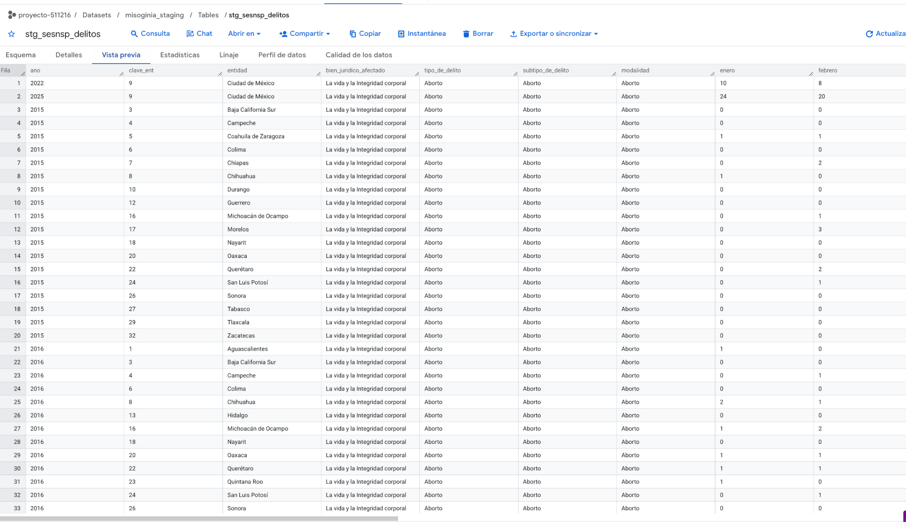{width=80% fig-align="center"}

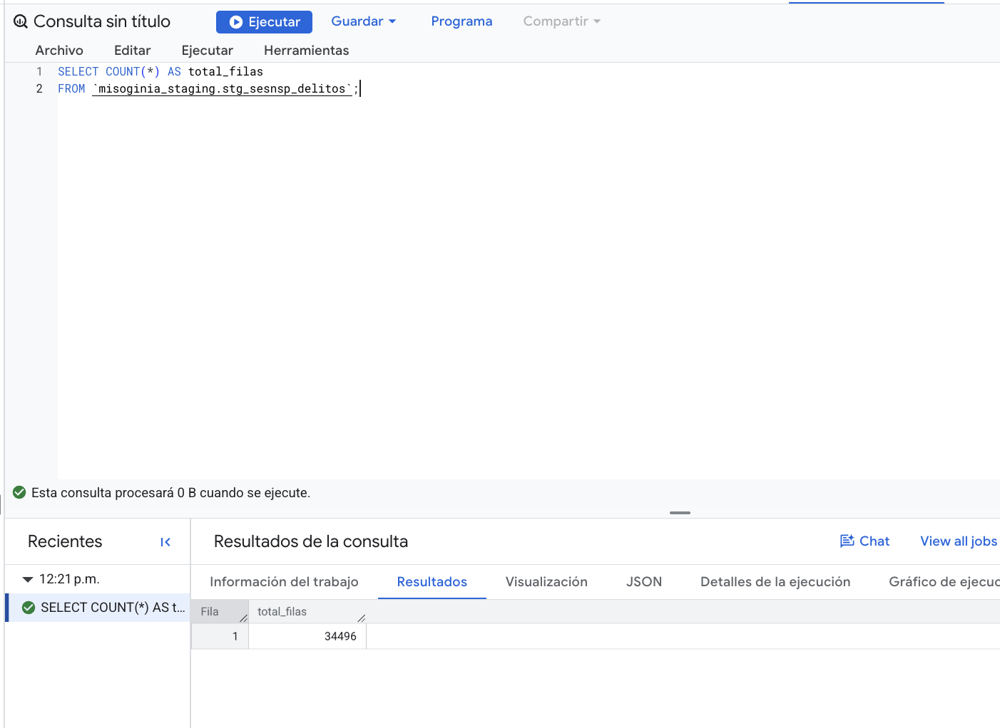{width=80% fig-align="center"}

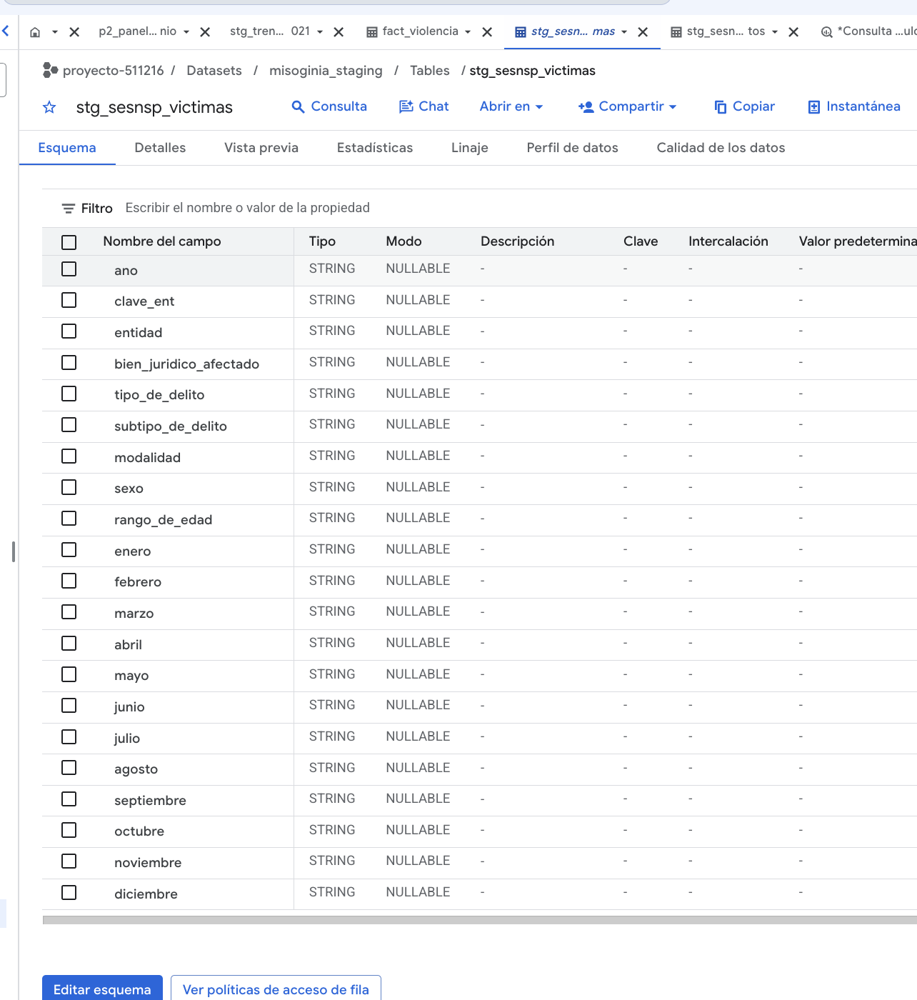{width=80% fig-align="center"}

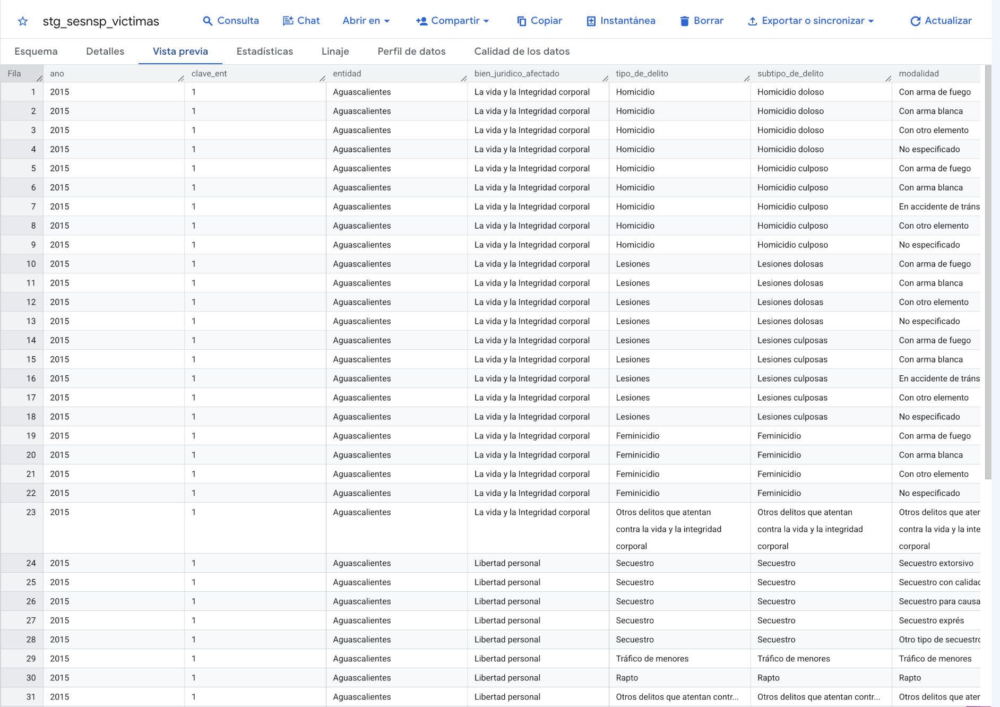{width=80% fig-align="center"}

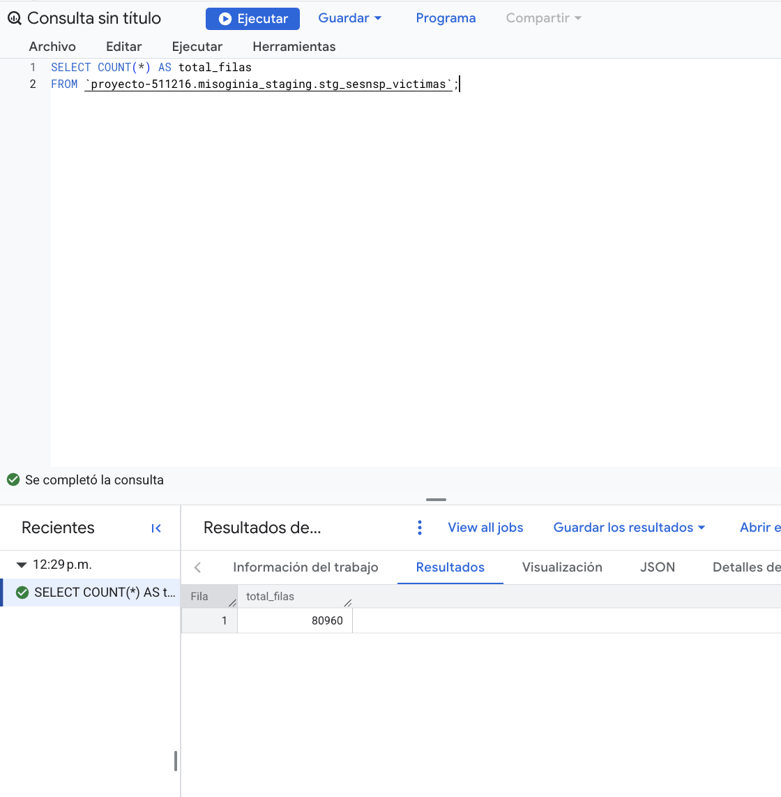{width=80% fig-align="center"}

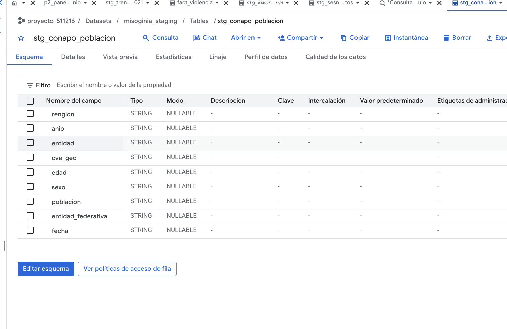{width=80% fig-align="center"}

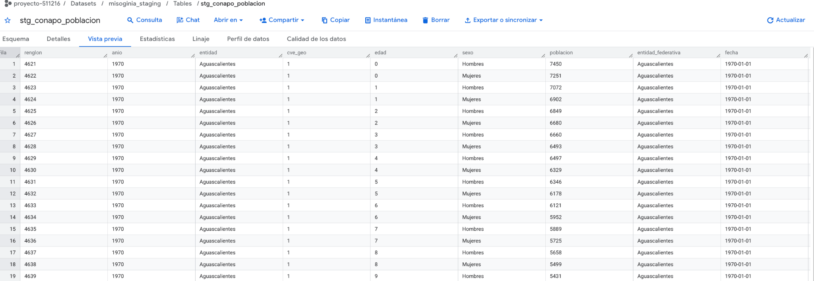{width=80% fig-align="center"}


{width=80% fig-align="center"}

{width=85% fig-align="center"}

{width=85% fig-align="center"}

### Cargas nuevas de staging

Las capturas siguientes comprueban la existencia y la estructura visible de las nuevas tablas. La extracción del catálogo de Kworb se validó en Colab con 300 IDs únicos, 112 textos distintos de artista, sin títulos ni artistas vacíos. En BigQuery se observó inicialmente una carga de 301 filas y 113 artistas, compatible con un encabezado cargado como dato; aún falta una nueva consulta `COUNT(*)` para confirmar su eliminación. No se atribuye a las tablas un conteo no verificado.

{width=85% fig-align="center"}

{width=85% fig-align="center"}

{width=85% fig-align="center"}

La consulta de conteos generales que se intentó ejecutar todavía no sirve como evidencia de número de filas: BigQuery devolvió un error por la referencia `misoginia_staging.INFORMATION_SCHEMA.TABLE_STORAGE`. Se conserva la captura del intento para revisar la consulta, no para atribuir conteos.

{width=85% fig-align="center"}


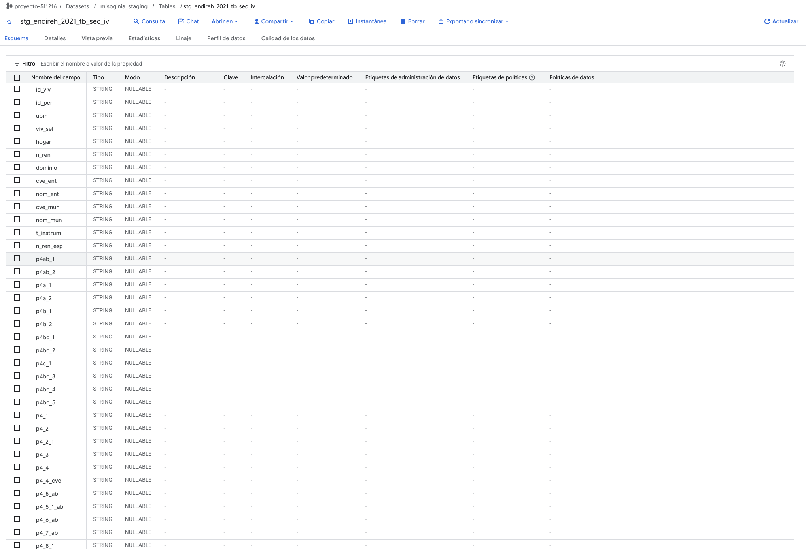{width=85% fig-align="center"}

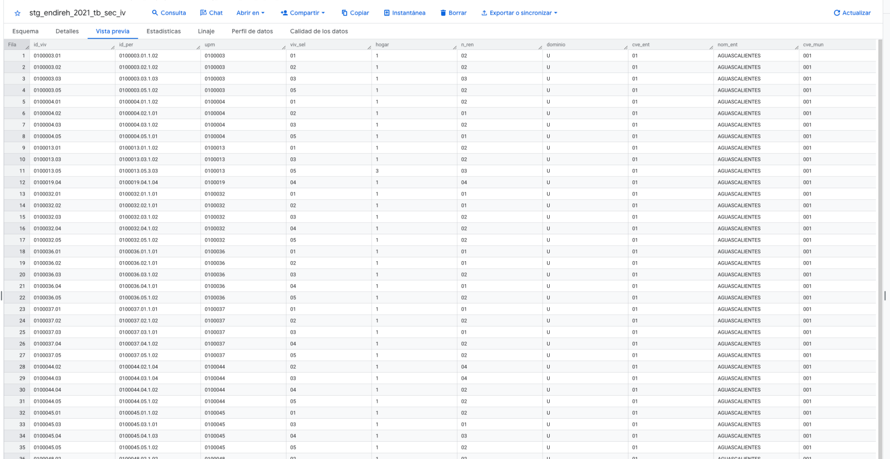{width=85% fig-align="center"}

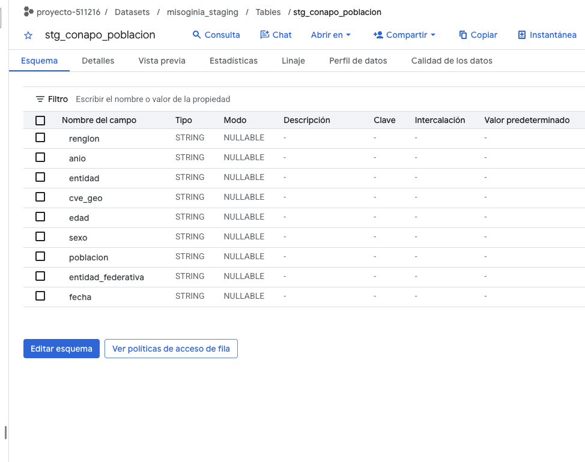{width=85% fig-align="center"}

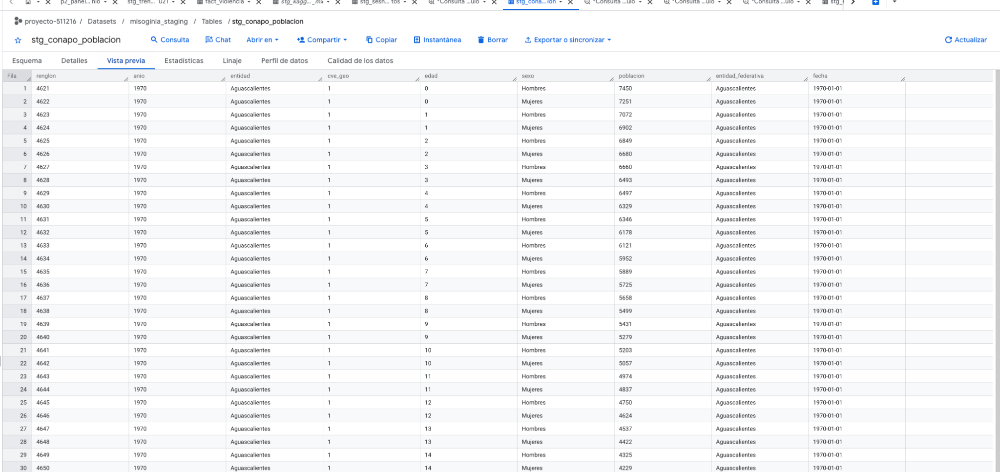{width=85% fig-align="center"}

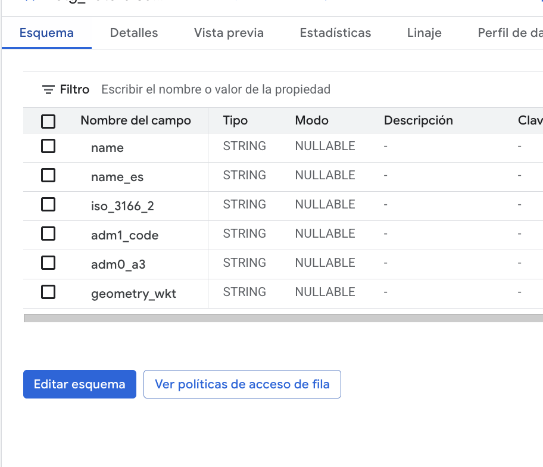{width=85% fig-align="center"}

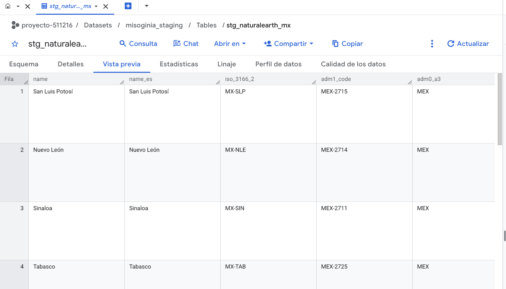{width=85% fig-align="center"}

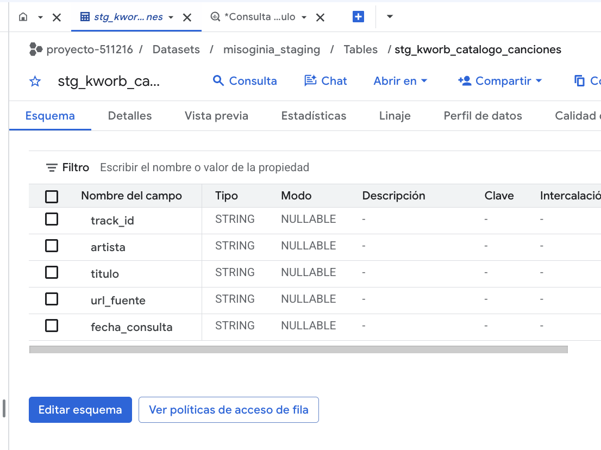{width=85% fig-align="center"}

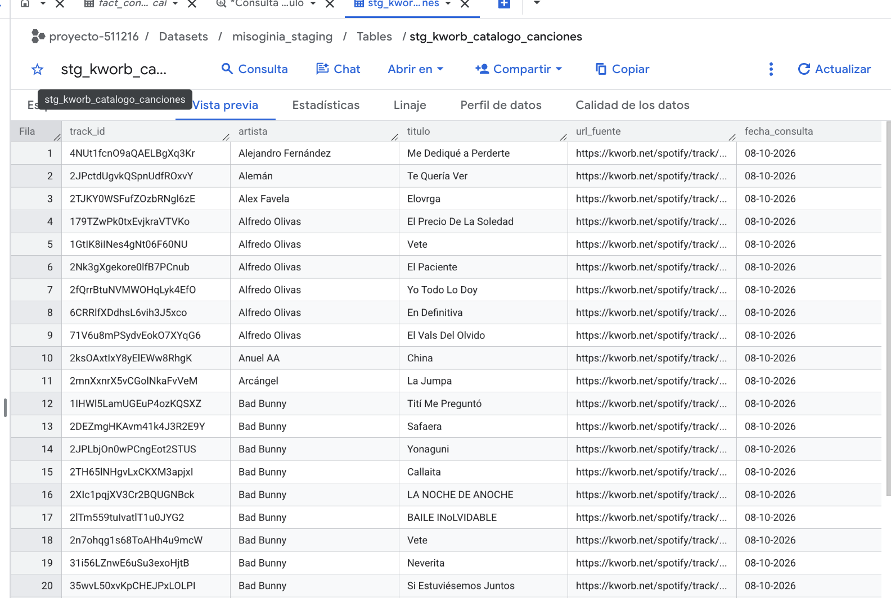{width=85% fig-align="center"}

<!-- Al cargar otra tabla de staging: agregar su fila a la tabla de arriba y sus capturas debajo,
     con el nombre img/bq_stg_<tabla>_<conteo|esquema|descripcion>.png -->

### Cómo se integrarán los datos en Silver

En E1 se cargan las fuentes a Bronze y se conservan sus campos originales como texto. **Las relaciones siguientes son el plan de integración, no transformaciones que ya se hayan ejecutado.** Silver preparará los datos por tema y Gold recibirá las dimensiones y hechos del esquema estrella.

1. **Canciones y consumo.** `stg_kworb_mx_semanal` y `stg_kworb_catalogo_canciones` se unirán por `track_id`. El catálogo recuperado de la misma página de Kworb identificó **300 canciones, 300 IDs únicos y 112 textos de artista distintos**, sin títulos ni artistas vacíos en Colab. La validación de carga en BigQuery sigue pendiente: el primer conteo mostró una fila adicional de encabezado. Kaggle servirá para contrastar charts en 2017–2021; la prueba por ID encontró **78 coincidencias exactas de 300**. La parte no coincidente no se descarta: ya tiene título y artista en el catálogo Kworb.
2. **Artistas, géneros y letras.** Se normalizarán los textos de artistas del catálogo; un nombre puede representar una colaboración o un grupo, por lo que **112 textos no equivalen necesariamente a 112 personas o grupos independientes**. MusicBrainz aportará etiquetas y géneros cuando la correspondencia del artista sea confiable, con revisión de homónimos; Last.fm servirá de respaldo documentado. MiSonGyny aporta etiquetas de referencia y LRCLIB se consulta en memoria para clasificar, sin almacenar letras completas. Se reportará la cobertura clasificada y la procedencia de cada etiqueta.
3. **Tiempo y entidades.** Las semanas de Kworb se distribuirán entre meses según los días que caigan en cada mes; SESNSP pasará de columnas mensuales a filas por mes. Las entidades de SESNSP, CONAPO, ENDIREH, Censo, RNPDNO, CONEVAL, ENDUTIH, Trends y Natural Earth se homologarán mediante `cve_ent` y un catálogo de equivalencias. Los indicadores anuales conservarán el año al que correspondan; no se rellenarán años faltantes sin una regla justificada.
4. **Consumo estimado por entidad.** Google Trends no contiene reproducciones: en `slv_pesos_trends` se construyen **pesos relativos estimados** por entidad y periodo, con el respaldo indicado en el diseño. Al repartir streams nacionales se comprobará que los pesos sumen uno y que las 32 entidades conserven el total. Los resultados estatales llevarán una marca de estimación.
5. **Violencia y contexto.** Se separarán carpetas de SESNSP, víctimas por sexo, y registros de desaparición de RNPDNO para no sumar medidas incompatibles ni duplicar personas. CONAPO proporcionará denominadores de tasas y las fuentes de contexto se integrarán por entidad y año. ENDIREH requiere factores de expansión para estimar prevalencias; porcentajes y tasas **no se sumarán** como si fueran conteos.

Después de comprobar llaves, granularidad, ausencia de duplicados y cobertura, `slv_canciones` alimentará `dim_cancion`, `slv_charts_mes` y `slv_pesos_trends` alimentarán `fact_consumo_musical`, `slv_violencia_mes` alimentará `fact_violencia`, y los catálogos de entidad, tipo de violencia y contexto alimentarán sus dimensiones. Las siete vistas del DataMart consultarán estas tablas una vez pobladas.

### Fragmentos de preparación de staging

El archivo completo está en [`datos/staging/preparar_staging_colab.py`](datos/staging/preparar_staging_colab.py). Los extractos siguientes muestran **qué se hizo antes de subir los CSV**; la validación, el tratamiento de errores y la descarga final permanecen en el script original. No son código de Silver: aquí solo hay selección de fuente, conversiones de formato y preparación técnica de carga.

**Kaggle (bloque B):** el archivo global es demasiado grande para subirlo desde la consola, así que se conserva la parte de México.

```python
for pedazo in pd.read_csv(csv_charts, chunksize=1_000_000, dtype=str):
    partes.append(pedazo[pedazo["region"] == "Mexico"])
kaggle_mx = pd.concat(partes, ignore_index=True)
guardar_y_bajar(kaggle_mx, "stg_kaggle_charts_mx")
```

**CONEVAL (bloque G):** se conservan las celdas de las hojas de Excel, indicando hoja y número de fila; aún no se calcula el indicador de pobreza.

```python
for nombre, h in hojas.items():
    h = h.copy()
    h.insert(0, "fila", range(1, len(h) + 1))
    h.insert(0, "hoja", nombre)
    partes.append(h)
coneval = pd.concat(partes, ignore_index=True)
```

**MiSonGyny (bloque H):** se juntan archivos de entrenamiento y prueba, conservando su procedencia mediante `archivo_origen`. Algunas etiquetas del conjunto TEST pueden venir vacías.

```python
for p in elegidos:
    df = pd.read_csv(p, dtype=str, sep=None, engine="python", encoding="utf-8-sig")
    df["archivo_origen"] = p.name
    partes.append(df)
misongyny = pd.concat(partes, ignore_index=True)
```

**Natural Earth (bloque F):** se filtran los registros de México y se representa la geometría como texto WKT para Bronze.

```python
mundo = gpd.read_file("ne_admin1.zip")
mex = mundo[mundo["adm0_a3"] == "MEX"].copy()
mex["geometry_wkt"] = mex.geometry.to_wkt()
```

**Catálogo de Kworb (extracción ejecutada en Colab):** se usó la tabla de totales semanales y se identificó cada canción a partir del enlace `../track/<ID>.html`; el artista se tomó del enlace `../artist/...` de la misma fila. El archivo generado se cruzó con los 300 `track_id` exportados de BigQuery.

```python
for fila in soup.select("tr"):
    enlaces = fila.find_all("a", href=True)
    enlace_cancion = next((a for a in enlaces if re.search(
        r"(?:^|/)track/[A-Za-z0-9]{22}\.html", a["href"])), None)
    if enlace_cancion is None:
        continue
    track_id = re.search(r"track/([A-Za-z0-9]{22})\.html", enlace_cancion["href"]).group(1)
    enlace_artista = next((a for a in enlaces if re.search(
        r"(?:^|/)artist/", a["href"])), None)
    registros.append({"track_id": track_id,
        "artista": enlace_artista.get_text(" ", strip=True) if enlace_artista else None,
        "titulo": enlace_cancion.get_text(" ", strip=True)})
```

**Pendientes con bloque disponible:** el mismo script contiene RNPDNO (bloque C, retiro de columnas de nombres y revisión adicional de privacidad), Censo ITER (bloque D, muestra que conserva totales), ENDUTIH (bloque E, conversión DBF a CSV) y MusicBrainz (bloque I, *muestra técnica de doce artistas*, no cobertura definitiva). **México Evalúa todavía requiere** localizar el indicador estatal pertinente en el informe y verificar sus valores antes de preparar el CSV. Estos procedimientos no se presentan como cargas ya realizadas.

## Análisis de integración

### Llaves de unión

| Llave | Fuentes y campo | Cómo se relacionan |
|---|---|---|
| Entidad | SESNSP, ENDIREH, CONAPO, Censo, ENDUTIH, CONEVAL, México Evalúa, Google Trends, Natural Earth | Todas se llevan a la clave INEGI de 1 a 32 con un catálogo de equivalencias. Trends cambia los nombres según el idioma del sitio: en inglés "Mexico City", "State of Mexico", "Yucatan"; en español "Estado de México", "Coahuila de Zaragoza", "Yucatán". Se descarga siempre en español y el catálogo guarda las dos versiones. |
| Tiempo | SESNSP por mes; RNPDNO por fecha de desaparición; Kworb por semana (de viernes a jueves); Kaggle por día; Trends por el periodo que se descargue; contexto por año | Cada semana de Kworb se reparte entre meses según sus días; Trends se descarga por año (y por mes si se puede); el contexto entra por entidad y año en `dim_contexto_entidad`. |
| ID de canción de Spotify | Kworb semanal, catálogo de Kworb y Kaggle *Spotify Charts* | El catálogo de Kworb relaciona los 300 IDs de la muestra con título y artista; Kaggle coincide por ID con 78 de las 300 canciones. La integración completa se prepara en silver. |
| Artista y título | Charts, MiSonGyny y LRCLIB | Se normalizan en `clave_cancion` para unir consumo, etiquetas de referencia y letras. |
| Artista | Charts, MusicBrainz, Last.fm y Google Trends | Asigna el género, las etiquetas y el tema de Trends (`termino_trends`). |
| Tipo de violencia | SESNSP y el clasificador | Se mapean a la LGAMVLV en `dim_tipo_violencia`. |

### Diferencias de granularidad y problemas anticipados

| Tema | Problema | Cómo se maneja |
|---|---|---|
| Consumo por entidad | Ninguna fuente abierta da reproducciones por entidad. | Se estima con Google Trends ([pivote](pivote.qmd)); toda salida por entidad lo indica. |
| Escala de Trends | Cada descarga se normaliza por separado (la entidad con más interés vale 100). Varios términos en una descarga suman 100 por entidad. | Un tema por descarga; el peso solo usa el reparto entre entidades dentro de cada descarga. |
| Escritura del término | "Reguetón" con acento da 17 estados con valor y "Regueton" sin acento 32, con otro orden. | Se descarga el tema de Trends, que reúne todas las escrituras; es estable entre descargas (correlación de 0.99). |
| Volumen bajo en periodos cortos | Tones And I tiene valor en 29 estados en 2021 y solo en 7 en tres meses de 2026. | Descargas por año; si un artista tiene menos de 28 estados con valor, se usa el tema del género, marcado en `origen_peso`. |
| Periodos | Kaggle solo cubre 2017–2021 y le faltan 34 días, casi todos de diciembre de 2021. | Kworb semanal es la fuente para toda la ventana 2015–2025; Kaggle solo valida. |
| Semanas que cruzan meses | Una semana de viernes a jueves puede caer en dos meses. | Se reparte por días; se supone consumo parejo dentro de la semana. |
| Tipos de violencia | El SESNSP no coincide uno a uno con la LGAMVLV y no mide violencia económica, patrimonial ni mediática. | Mapeo en `dim_tipo_violencia`, con los tipos sin delito visibles en P4. |
| Coincidencia en MusicBrainz | La búsqueda que toma el primer resultado asignó a Sebastián Yatra las etiquetas de un compositor clásico alemán. | Validar país, tipo de artista y puntaje de la búsqueda; revisar a mano los casos dudosos. |
| Nombres ambiguos en Trends | Artistas como Matisse, Aleman o Intocable comparten nombre con palabras o con otras personas. | El tema identifica a la persona o al grupo, no la palabra; si no hay tema, se usa el peso del género. |
| RNPDNO escaso | Solo 3,311 registros de mujeres con fecha entre 2017 y 2023, y termina en agosto de 2023. | Se usa solo agregado a año en P2. |
| Sexo de la víctima | El archivo de delitos no dice el sexo; el de víctimas solo cubre algunos delitos. | Dos medidas separadas: `carpetas` y `victimas_mujeres`. |
| Contexto incompleto | CONEVAL es de años pares, la ENDIREH tiene un levantamiento en la ventana y el Censo solo 2020. | Se guardan en el año que corresponde y se dejan vacíos los demás. |

Cada fuente tiene además sus propios problemas, descritos en su ficha del [catálogo de fuentes](fuentes.qmd).
