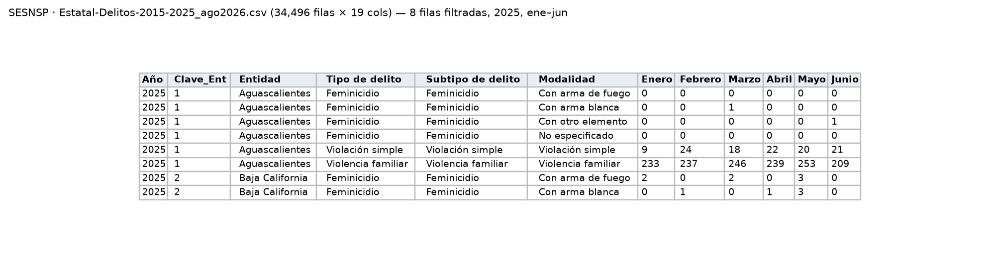
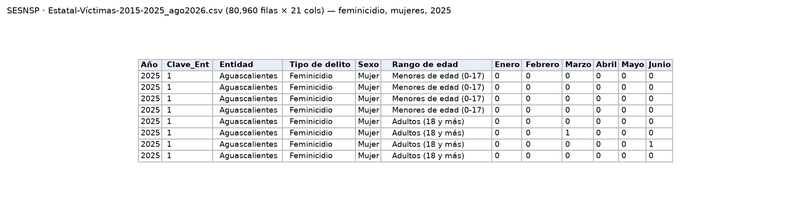

Cifras oficiales de carpetas de investigación (delitos) y de víctimas, por entidad y mes. Es la fuente principal de violencia de género del proyecto.

| Campo | Descripción |
|---|---|
| **Nombre y dueño** | Incidencia delictiva del fuero común — Delitos y Víctimas. Secretariado Ejecutivo del Sistema Nacional de Seguridad Pública, órgano del Gobierno de México que concentra las cifras de las fiscalías estatales. |
| **URL** | <https://www.gob.mx/sesnsp/acciones-y-programas/datos-abiertos-de-incidencia-delictiva> |
| **Acceso** | Descarga directa de dos ZIP (*2015–2025, Fuero común, Delitos/Víctimas, estatal*). Corte: agosto 2026. |
| **Formato y tamaño** | CSV latin-1. Delitos: 4.6 MB, 34,496 filas, 19 columnas. Víctimas: 12.4 MB, 80,960 filas, 21 columnas. |
| **Grano** | Delitos: una fila por entidad, año, tipo, subtipo y modalidad, con 12 columnas mensuales. Víctimas: además sexo y rango de edad. |
| **Cobertura** | Enero 2015 – diciembre 2025, mensual; actualización mensual. |
| **Información de México** | 32 entidades. Incluye feminicidio, violencia familiar, violación, abuso, acoso y hostigamiento sexual, y "violencia de género en todas sus modalidades distinta a la violencia familiar". |
| **Licencia y restricciones** | Datos abiertos del Gobierno de México. Datos agregados, sin información personal. |
| **Llaves de integración** | `Clave_Ent`: número de entidad del INEGI (1 = Aguascalientes … 32 = Zacatecas); se une con `CVE_ENT` de ENDIREH y `CVE_GEO` de CONAPO. `Año` + columna del mes: forman la fecha mensual que se une con los charts musicales agregados por mes. `Tipo de delito`: se traduce a un tipo de violencia de la LGAMVLV para compararlo con ENDIREH y con las etiquetas de la música. |
| **Preguntas de E0** | P2, P3, P4. |

{width=55% fig-align="center"}

{width=100% fig-align="center"}

{width=100% fig-align="center"}

## Problemas anticipados para la integración

- El SESNSP ha usado tres metodologías para registrar los delitos: una de 1997 a 2017, otra de 2015 a 2025 y una nueva a partir de 2026. Según su nota metodológica, la de 2026 se diseñó para ser comparable con la anterior, pero cambió la forma de registrar el feminicidio, que ahora separa la tentativa e incluye de forma explícita los transfeminicidios, y agregó el delito de violación a la intimidad sexual, que antes se contaba dentro de otras categorías [[2]](../referencias.qmd).
- Los meses aparecen como columnas, a diferencia de las demás fuentes, y el archivo usa una codificación de caracteres distinta.
- El archivo de víctimas solo indica el sexo en algunos delitos; en la violencia familiar y en los delitos sexuales no se sabe si la víctima fue mujer.
- La fuente clasifica delitos, mientras que la referencia del proyecto son los tipos de violencia de la LGAMVLV, por lo que no hay una equivalencia directa entre ambas clasificaciones.

[← Volver a fuentes de datos](../fuentes.qmd)
