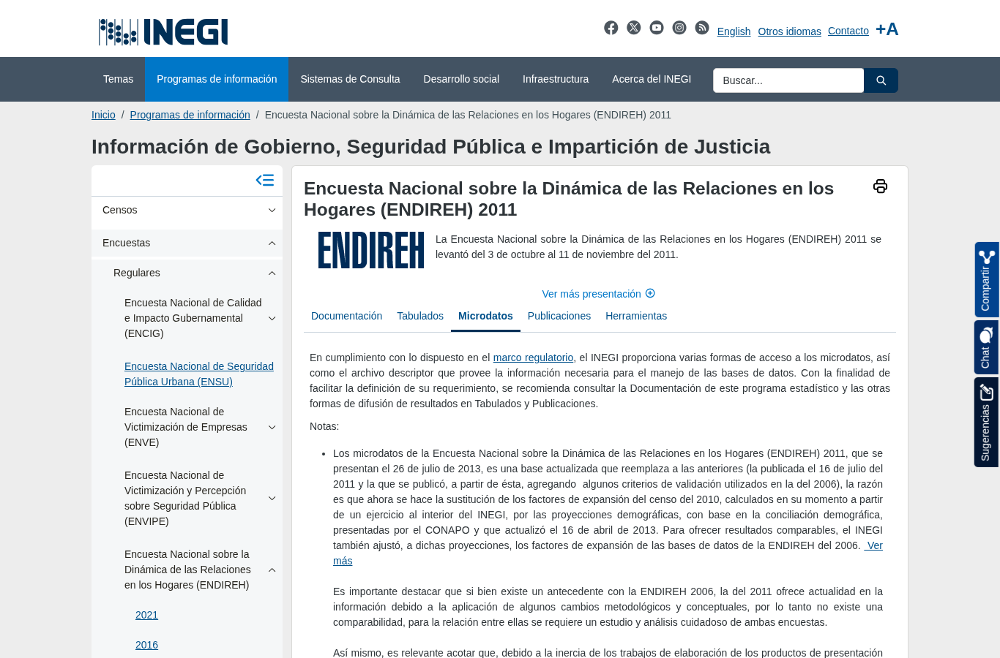
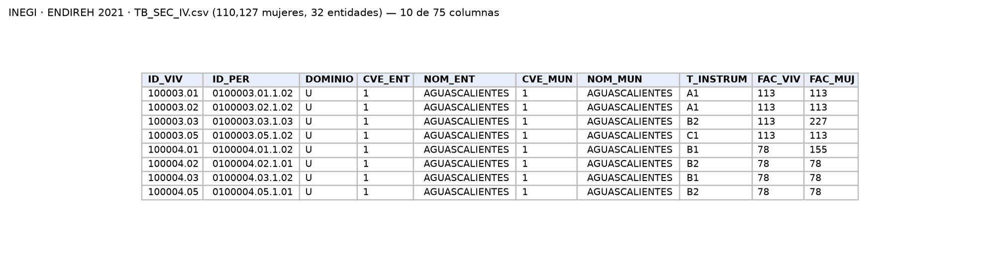

Encuesta a mujeres de 15 años y más sobre violencia psicológica, física, sexual, económica y patrimonial; sus tipos coinciden con los del artículo 6 de la LGAMVLV.

| Campo | Descripción |
|---|---|
| **Nombre y dueño** | Encuesta Nacional sobre la Dinámica de las Relaciones en los Hogares. Instituto Nacional de Estadística y Geografía, organismo autónomo responsable de la estadística oficial de México. |
| **URL** | <https://www.inegi.org.mx/programas/endireh/> (una página por edición, pestaña *Microdatos*). |
| **Acceso** | Descarga directa de un ZIP por edición. |
| **Formato y tamaño** | CSV latin-1, una tabla por sección del cuestionario. ZIP: 2003 9.3 MB; 2006 25.0 MB; 2011 28.2 MB; 2016 100.8 MB; 2021 78.9 MB. |
| **Grano** | Una fila por mujer entrevistada (o por integrante del hogar en tablas sociodemográficas); se expande con el factor de la mujer. |
| **Cobertura** | 5 levantamientos, de 2003 a 2021; sin serie mensual. |
| **Información de México** | Las 5 ediciones traen `CVE_ENT` con las 32 entidades (y municipio). 2021: 110,127 mujeres en `TB_SEC_IV`; 2016: 111,256. |
| **Licencia y restricciones** | Términos de libre uso del INEGI. Microdatos anonimizados; no representativa a nivel municipal. |
| **Llaves de integración** | `CVE_ENT`: clave INEGI de la entidad, se une con `Clave_Ent` del SESNSP y `CVE_GEO` de CONAPO. Año de levantamiento: se une con el año de las demás fuentes. Tipo de violencia (psicológica, física, sexual, económica, patrimonial): coincide directamente con la LGAMVLV y sirve de puente con SESNSP y con las etiquetas de la música. |
| **Preguntas de E0** | P2, P3, P4. |

::: {layout-ncol=2}

:::

{width=100% fig-align="center"}

## Problemas anticipados para la integración

- El INEGI advierte que las ediciones no siempre son comparables entre sí; en particular, la de 2011 no es comparable con la de 2006 por cambios metodológicos y conceptuales [[3]](../referencias.qmd). El cuestionario y la organización de las tablas también cambian de una edición a otra.
- La encuesta se levanta cada cinco años, por lo que dentro de la ventana 2017–2025 solo hay una edición, la de 2021.
- Mide la violencia vivida por las mujeres en periodos de referencia propios de la encuesta, que no coinciden con los registros mensuales del SESNSP.
- Es una muestra: sus resultados representan a la población solo cuando se usan los factores de expansión.
- La clave de entidad tiene un formato distinto al que usan el SESNSP y CONAPO.

[← Volver a fuentes de datos](../fuentes.qmd)
