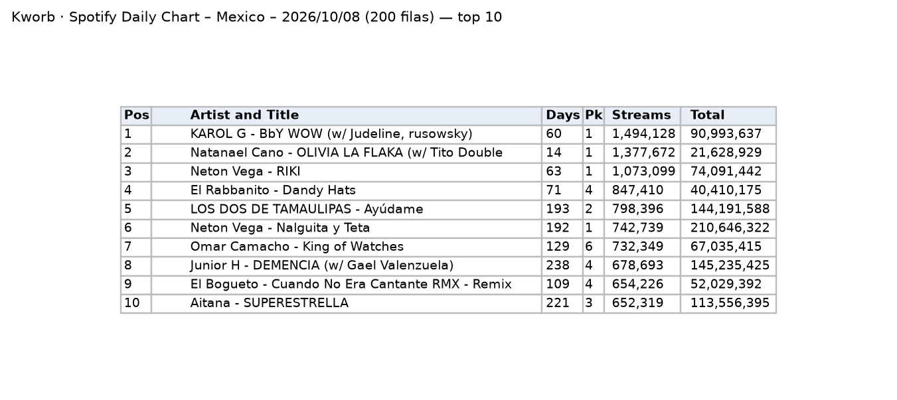

Sitio que recopila diariamente los charts públicos de Spotify. Es la **fuente de streams del almacén para toda la ventana 2015–2025**, a partir del historial semanal de cada canción (ver [pivote](../pivote.qmd#evidencia-kworb)). Ofrece dos vistas que usamos:

- **Chart de México:** la lista de las 200 canciones más escuchadas en México en un día. Cada fila es una canción: posición, días en el chart, pico y streams de ese día (figura izquierda).
- **Historial de una canción:** cada fila es una semana (o un día, en la vista diaria) y cada columna un país. Por ejemplo, en el historial de "KAROL G – BbY WOW" (<https://kworb.net/spotify/track/3h5T5JypYU7huFiVYhv1dr.html>) la celda del 8 de septiembre de 2026 en la columna `MX` dice `1 (2,427,912)`: ese día fue la número 1 en México con 2,427,912 streams (figura derecha).

| Campo | Descripción |
|---|---|
| **Nombre y dueño** | Kworb.net, sitio independiente que recopila charts públicos de música (Spotify, YouTube, iTunes, entre otros). |
| **URL** | <https://kworb.net/spotify/country/mx_daily.html> |
| **Acceso** | Páginas HTML públicas. La página cambia a diario. |
| **Formato y tamaño** | Tabla HTML; chart diario de 200 filas. |
| **Grano** | Chart: una fila por canción y día. Historial: una fila por semana y canción, con posición y streams por país; la fecha es el jueves en que termina la semana. |
| **Cobertura** | Chart semanal de México del 28 de abril de 2013 al presente, con streams desde la semana del 9 de junio de 2013; 5,146 canciones en la lista de totales semanales. El chart diario está desde 2017. La canción con más tiempo en el chart diario de México acumula 3,447 días. |
| **Información de México** | Página propia "Spotify Daily Chart – Mexico" y columna `MX` en el historial de cada canción. Solo nivel nacional. |
| **Licencia y restricciones** | Sin licencia explícita; datos agregados públicos. Uso académico; no se republican filas crudas. |
| **Llaves de integración** | ID de canción de Spotify: código de 22 caracteres en el enlace de cada canción (en el ejemplo, `3h5T5JypYU7huFiVYhv1dr`); se une exacto con Kaggle. Artista y título: unen con MiSonGyny y LRCLIB, que no tienen ese ID. Fecha: se relaciona con el mes de SESNSP. |
| **Preguntas de E0** | P1, P2, P3. |

::: {layout-ncol=2}

:::

{width=85% fig-align="center"}

{width=60% fig-align="center"}

## Problemas anticipados para la integración

- El artista, el título y los artistas invitados aparecen juntos en un mismo texto.
- En el historial de cada canción, la posición y el número de reproducciones aparecen juntos en una misma celda.
- Solo hay datos a nivel nacional, por lo que no permite analizar el consumo por entidad.
- La página se actualiza todos los días y no conserva versiones anteriores del chart.
- El historial completo requiere una página por canción: 5,146 páginas, que se descargan a una cada 1.5 segundos y se guardan para no repetir. El `robots.txt` del sitio permite la descarga.
- Una misma canción puede tener otro ID en Kaggle; para validar solo se comparan canciones con el mismo ID.
- Validación: en 2021, el streams semanal de Kworb es idéntico a la suma de los 7 días de Kaggle en 15 de 15 semanas comparables.

[← Volver a fuentes de datos](../fuentes.qmd)
