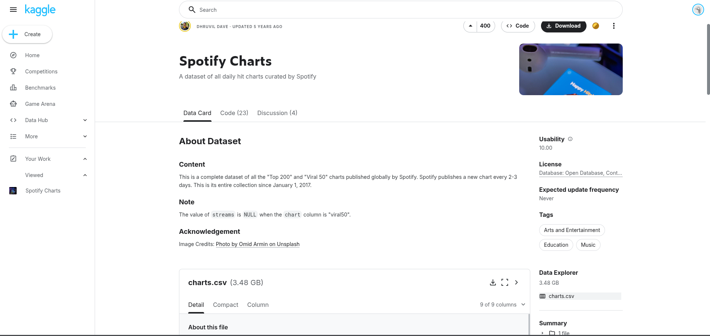
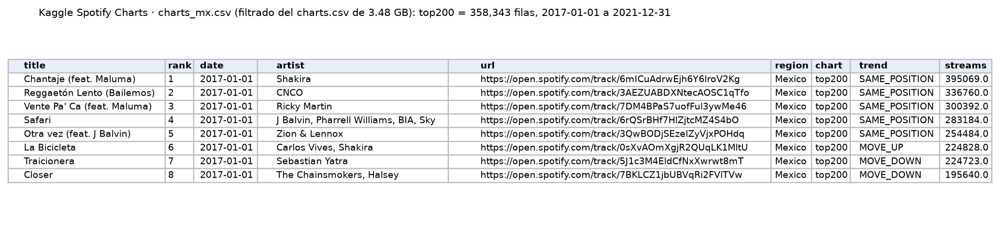
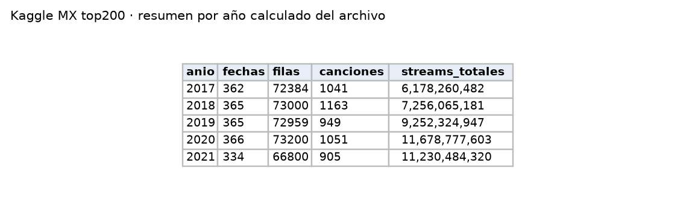

Colección completa de los charts diarios de Spotify. En el almacén **sirve para validar** los streams semanales de Kworb (F4) en 2017–2021: la suma de 7 días coincide al stream con la semana de Kworb.

| Campo | Descripción |
|---|---|
| **Nombre y dueño** | *Spotify Charts*, publicado en Kaggle (plataforma de datasets de Google) por el usuario Dhruvil Dave, a partir de los charts publicados por Spotify. |
| **URL** | <https://www.kaggle.com/datasets/dhruvildave/spotify-charts> |
| **Acceso** | Descarga con cuenta de Kaggle (ZIP de 991 MB con `charts.csv` de 3.48 GB). |
| **Formato y tamaño** | CSV con 9 columnas (`title, rank, date, artist, url, region, chart, trend, streams`). Global: 26,173,514 filas. México: 448,832 filas (60.8 MB). |
| **Grano** | Una fila por canción, posición, fecha, país y tipo de chart (Top 200 o Viral 50). |
| **Cobertura** | 2017-01-01 a 2021-12-31, diario. Sin actualizaciones. |
| **Información de México** | La columna `region` incluye `"Mexico"`: 358,343 filas del Top 200 (con streams en todas) y 90,489 del Viral 50; 1,792 fechas y 3,748 canciones distintas. |
| **Licencia y restricciones** | "Database: Open Database, Contents: © Original Authors". El contenido son charts de Spotify: uso académico, sin republicar filas crudas. |
| **Llaves de integración** | ID de canción de Spotify: al final de la columna `url` (p. ej. `open.spotify.com/track/6mICuAdrwEjh6Y6lroV2Kg`); coincide con el de Kworb. `date`: se relaciona con el mes de SESNSP. `artist` y `title`: para unir con MiSonGyny y LRCLIB. |
| **Preguntas de E0** | P1, P2, P3. |

{width=55% fig-align="center"}

{width=100% fig-align="center"}

{width=60% fig-align="center"}

## Problemas anticipados para la integración

- Faltan 34 días, la mayoría de diciembre de 2021, y la serie termina ese año. La comparación con Kworb lo confirmó: las semanas de diciembre de 2021 no coinciden porque aquí faltan días.
- Una parte de las canciones no tiene el mismo identificador que en Kworb, porque una misma canción puede tener varios identificadores en Spotify.
- El archivo completo es demasiado grande para cargarlo directamente en BigQuery desde la consola.

[← Volver a fuentes de datos](../fuentes.qmd)
