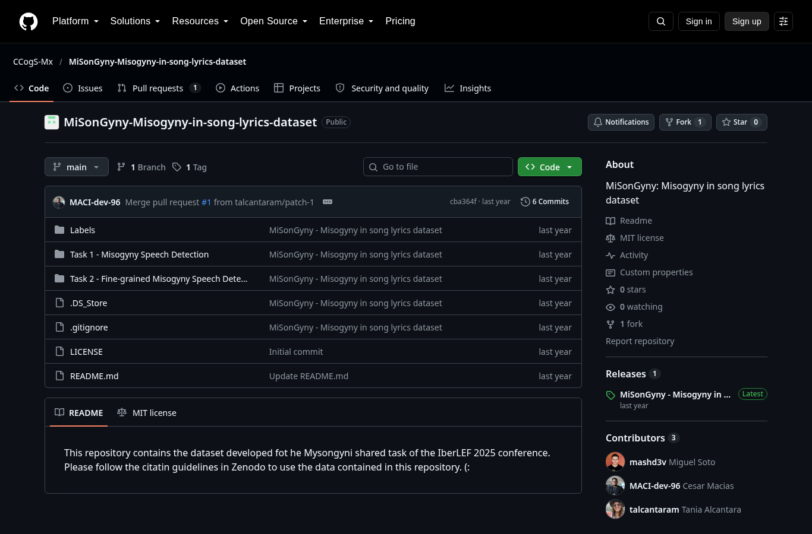
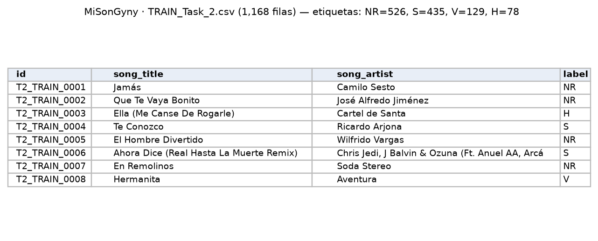

Canciones en español etiquetadas por misoginia; sirve para entrenar y validar el clasificador.

| Campo | Descripción |
|---|---|
| **Nombre y dueño** | *MiSonGyny: Misogyny in song lyrics dataset*. Computing Cognitive Science Lab (CCogS-Mx, laboratorio con sede en México según su perfil de GitHub), creado para la tarea compartida MiSonGyny de IberLEF 2025 (*Iberian Languages Evaluation Forum*, foro anual de tareas compartidas de procesamiento de lenguaje en español y otras lenguas ibéricas). |
| **URL** | <https://github.com/CCogS-Mx/MiSonGyny-Misogyny-in-song-lyrics-dataset> |
| **Acceso** | Descarga del repositorio (también publicado en Zenodo). |
| **Formato y tamaño** | CSV. Tarea 1: misógina / no misógina. Tarea 2: sexualización, violencia, odio o no relacionada. 4,092 filas, 2,631 canciones únicas. |
| **Grano** | Una fila por canción etiquetada (`id, song_title, song_artist, label`). No incluye la letra. |
| **Cobertura** | Música en español de varias décadas; sin fecha por canción. |
| **Información de México** | 444 de sus canciones aparecen en el histórico del chart de Spotify México (Kworb). |
| **Licencia y restricciones** | MIT. |
| **Llaves de integración** | `song_artist` y `song_title`: se unen con artista y título de Kworb, Kaggle y LRCLIB. `label`: su categoría se relaciona con los tipos de violencia de la LGAMVLV. |
| **Preguntas de E0** | P1, P3, P4. |

{width=55% fig-align="center"}

{width=75% fig-align="center"}

## Problemas anticipados para la integración

- No incluye la letra de las canciones, solo el título, el artista y la etiqueta.
- Sus categorías de sexualización, violencia y odio no corresponden a los tipos de violencia del artículo 6 de la LGAMVLV; se acercan más a la violencia mediática del artículo 20 Quinquies.
- Es un corpus para entrenar y validar el clasificador, no un registro de consumo musical.
- Los títulos y los nombres de los artistas pueden estar escritos de forma distinta que en los charts.

[← Volver a fuentes de datos](../fuentes.qmd)
