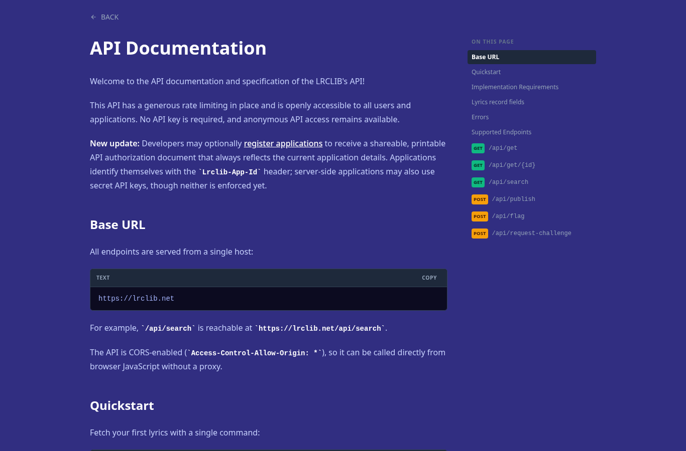
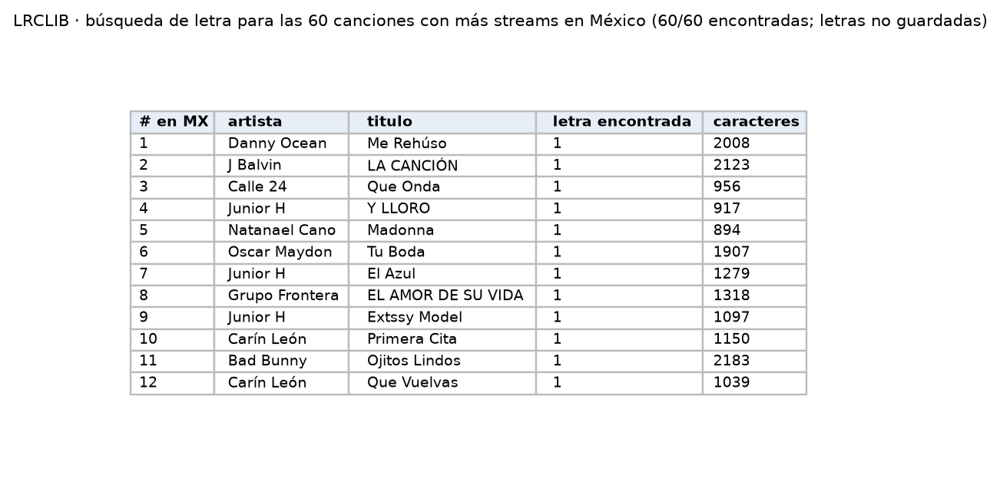

Biblioteca abierta de letras; es la entrada de texto para el clasificador.

| Campo | Descripción |
|---|---|
| **Nombre y dueño** | LRCLIB, "Free & Open Lyrics Library": proyecto comunitario de código abierto que publica su API y descargas completas de su base de datos. |
| **URL** | <https://lrclib.net/docs> |
| **Acceso** | API REST sin llave (búsqueda por artista y título). |
| **Formato y tamaño** | JSON; una letra mediana ocupa ≈1.3 KB. |
| **Grano** | Una fila por grabación (título, artista, álbum, duración, letra). |
| **Cobertura** | Sin fecha; catálogo global. |
| **Información de México** | Se encontró la letra de las 60 canciones con más streams en México (Kworb). |
| **Licencia y restricciones** | API de uso libre. Las letras tienen derechos de autor: no se publican; solo variables derivadas. |
| **Llaves de integración** | Artista y título: se buscan con los de Kworb y Kaggle. Duración: permite distinguir versiones de una misma canción. |
| **Preguntas de E0** | P1, P3, P4. |

{width=55% fig-align="center"}

{width=80% fig-align="center"}

## Problemas anticipados para la integración

- La búsqueda por artista y título puede devolver otra versión de la canción o la interpretación de otro artista.
- La cobertura se comprobó con las canciones más escuchadas y puede ser menor en canciones menos populares.
- Las letras tienen derechos de autor, por lo que no pueden publicarse.

[← Volver a fuentes de datos](../fuentes.qmd)
