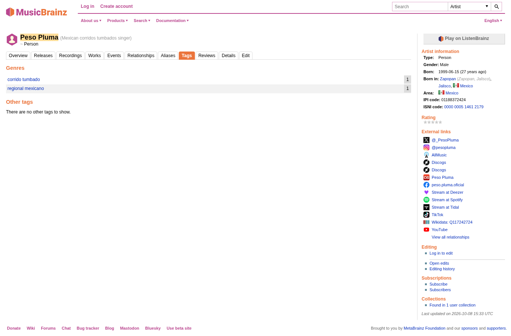
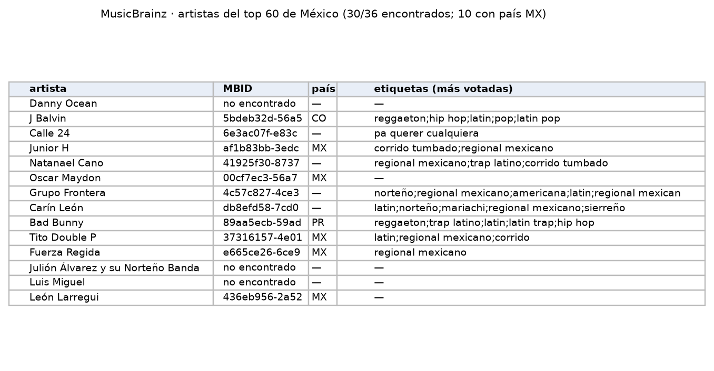

Enciclopedia musical abierta; aporta país y etiquetas de género de cada artista para desagregar por género musical.

| Campo | Descripción |
|---|---|
| **Nombre y dueño** | MusicBrainz, enciclopedia musical de código abierto mantenida por su comunidad y sostenida por la MetaBrainz Foundation (organización sin fines de lucro). |
| **URL** | <https://musicbrainz.org/doc/MusicBrainz_API> |
| **Acceso** | API REST sin llave, máximo 1 petición por segundo. |
| **Formato y tamaño** | JSON; ≈1 KB por artista. |
| **Grano** | Una fila por artista (identificador, nombre, país, etiquetas con votos). |
| **Cobertura** | Global, sin fecha. |
| **Información de México** | De los 36 artistas del top 60 de México, 30 se encontraron; 10 tienen país MX y 11 la etiqueta "regional mexicano". |
| **Licencia y restricciones** | Datos centrales CC0 (dominio público). |
| **Llaves de integración** | Nombre del artista: se busca con el artista de Kworb y Kaggle. Identificador de MusicBrainz: código único y estable por artista que evita confundir homónimos una vez encontrado. |
| **Preguntas de E0** | P1, P3. |

{width=55% fig-align="center"}

{width=90% fig-align="center"}

Prueba con los 50 artistas con más streams de 2017 a 2021 (código y salida completa en `datos/pruebas/`):

```text
Con etiquetas: 48 de 50
Sin etiquetas: ['León Larregui', 'Cartel De Santa']
Bad Bunny ['reggaeton', 'trap latino', 'latin', 'latin trap', 'hip hop', 'pop', 'spanish', 'english']
Christian Nodal ['ranchera', 'latin', 'mariachi', 'regional mexicano', 'vivo en el 6']
Luis Miguel ['pop', 'latin ballad', 'mexican', 'ballad', 'latin', 'bolero', 'ranchera', 'national folk']
Sebastian Yatra ['classical', 'baroque', 'composer', 'german', 'european', 'gramophone selection', 'instrumental', 'german composer']
```


## Problemas anticipados para la integración

- Las etiquetas de género las asignan los usuarios, no siguen un catálogo fijo y algunas no describen un género musical.
- Algunos artistas tienen el mismo nombre que otros y varios no tienen país registrado.
- Tomar solo el primer resultado de la búsqueda produce coincidencias falsas: en la prueba con los 50 artistas más escuchados, a Sebastián Yatra se le asignaron las etiquetas de un compositor clásico alemán. Cada coincidencia se valida con el país, el tipo de artista y el puntaje de la búsqueda, y los casos dudosos se revisan a mano.

[← Volver a fuentes de datos](../fuentes.qmd)
