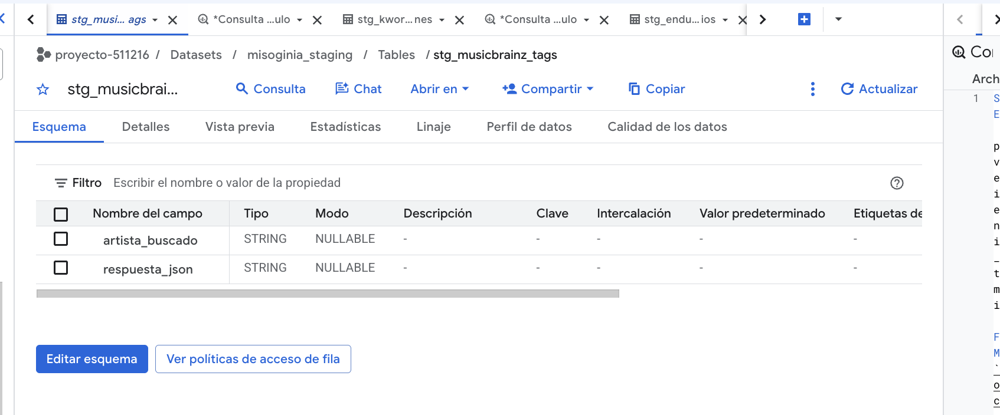
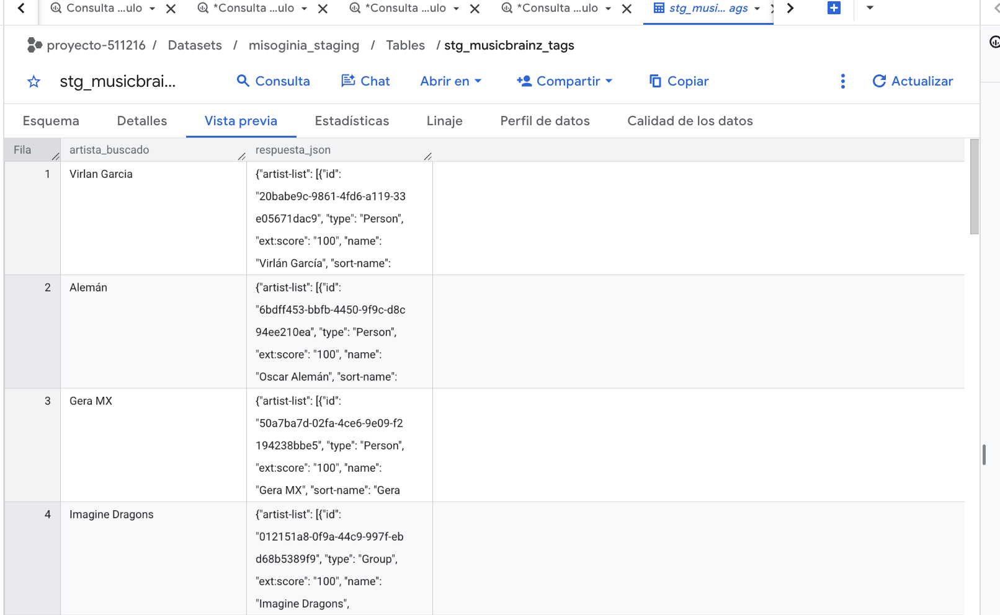

MusicBrainz se incorporó como fuente de referencia para contrastar nombres de artistas presentes en el catálogo mexicano de Kworb. La tabla Bronze `stg_musicbrainz_tags` conserva el nombre consultado y la respuesta íntegra de búsqueda en formato JSON. Esta distinción es relevante: **un resultado de búsqueda no es todavía una identificación inequívoca del artista ni una etiqueta musical validada**.

| Campo | Descripción |
|---|---|
| **Responsable** | MusicBrainz, proyecto de MetaBrainz Foundation. |
| **Acceso** | API pública REST: <https://musicbrainz.org/doc/MusicBrainz_API>. Se aplica una pausa mayor a un segundo entre peticiones y se declara un agente de usuario. |
| **Universo consultado** | Nombres de artista distintos extraídos de las 300 canciones del catálogo Kworb; 112 textos distintos identificados en la preparación previa. Un texto puede designar una colaboración y no equivale necesariamente a un artista único. |
| **Formato y grano de Bronze** | Una respuesta JSON por nombre consultado, con `artista_buscado` y `respuesta_json` como `STRING`. |
| **Restricciones** | Los datos centrales de MusicBrainz son CC0; las etiquetas comunitarias y otros contenidos complementarios deben revisarse conforme a sus licencias específicas antes de redistribuirlos. |
| **Integración** | La resolución de identidades, homónimos, coincidencias y etiquetas se realizará en Silver, conservando el identificador MusicBrainz y la confianza de cada correspondencia. |

## Carga realizada

El proceso de consultas tomó como punto de partida los nombres presentes en `stg_kworb_catalogo_canciones`, sin limitar arbitrariamente la búsqueda a los doce nombres del ensayo inicial. La interfaz de BigQuery permite comprobar la existencia de `stg_musicbrainz_tags` y sus dos columnas. La consulta de control sobre la tabla cargada confirmó **112 filas**. Este resultado verifica la cantidad de respuestas almacenadas, pero no la resolución correcta de los artistas ni la ausencia de errores en la API.

{width=85% fig-align="center"}

{width=85% fig-align="center"}

El procedimiento reproducible figura en [`preparar_staging_colab.py`](../datos/staging/preparar_staging_colab.py), bloque I, y en su versión [`preparar_staging_colab.ipynb`](../datos/staging/preparar_staging_colab.ipynb).

[← Volver a fuentes de datos](../fuentes.qmd)
