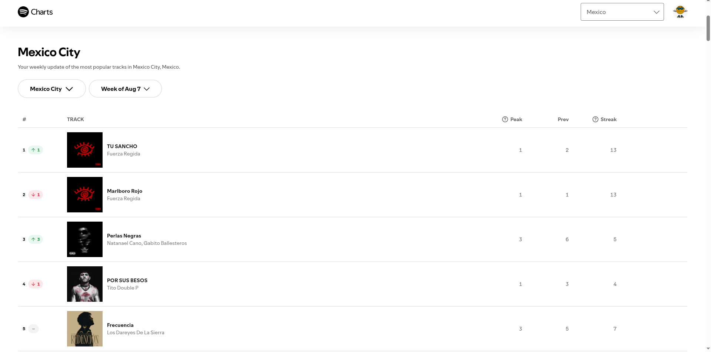

Portal oficial de Spotify y única fuente con consumo musical por ciudad. Se acepta solo como referencia de consulta para contrastar, en las ciudades disponibles, lo que muestra Google Trends por estado.

| Campo | Descripción |
|---|---|
| **Nombre y dueño** | Spotify Charts, portal de Spotify AB (empresa sueca de streaming de música). |
| **URL** | <https://charts.spotify.com/charts/view/citytoptrack-mexicocity-weekly/2025-08-07> |
| **Acceso** | Requiere cuenta de Spotify; consulta en pantalla, sin opción de descarga. |
| **Formato y tamaño** | Página web. |
| **Grano** | Una fila por canción y semana en cada ciudad: posición, pico, posición previa y racha. |
| **Cobertura** | Semanal. |
| **Información de México** | El equipo verificó el chart semanal de la Ciudad de México (semana del 7 de agosto de 2025). |
| **Licencia y restricciones** | Términos de uso: solo uso personal; prohíben *scraping* o cualquier medio automatizado, copiar, redistribuir o mostrar públicamente el contenido. |
| **Llaves de integración** | Ciudad, semana, artista y título. |
| **Decisión** | **Aceptada con limitaciones:** cumple los criterios C1, C2 y C3. Cumple C4 solo de forma parcial, porque sus términos de uso permiten consultar los charts en pantalla para uso personal, pero prohíben extraer, copiar o redistribuir su contenido. Por eso se usa únicamente como referencia de consulta y sus datos no se cargan al almacén. |

{width=60% fig-align="center"}

## Problemas anticipados para la integración

- No ofrece opción de descarga y sus términos de uso prohíben cualquier extracción automatizada o copia del contenido.
- No muestra el número de reproducciones, solo la posición de cada canción.
- Solo existe para algunas ciudades, no para todas las entidades.
- Requiere una cuenta de Spotify para consultarse.

[← Volver a fuentes de datos](../fuentes.qmd)
