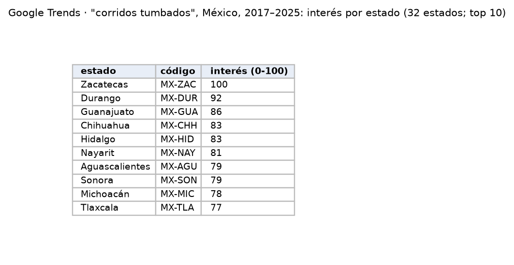
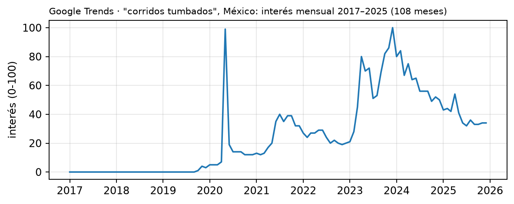

Índice de interés de búsqueda de Google por estado y periodo. Es la única fuente aceptada que aproxima el consumo musical **por entidad**: no mide reproducciones, sino qué tanto se busca un género o artista en cada estado.

| Campo | Descripción |
|---|---|
| **Nombre y dueño** | Google Trends, servicio de Google LLC que publica el interés relativo de búsqueda por región y periodo. |
| **URL** | <https://trends.google.com/trends/explore?geo=MX> |
| **Acceso** | Descarga de CSV desde el sitio, un término por descarga, con el sitio en español (verificado el 9 y el 10 de octubre de 2026; ver [pivote](../pivote.qmd#evidencia-trends)). También con la biblioteca `pytrends`, que no es oficial; Google limita el número de consultas. |
| **Formato y tamaño** | Tablas pequeñas por consulta: 32 filas por estado o una fila por periodo. |
| **Grano** | Interés por estado: una fila por estado y término, para todo el periodo consultado. Interés en el tiempo: una fila por mes y término, a nivel nacional. |
| **Cobertura** | Desde 2004 hasta hoy. Prueba: "corridos tumbados", 2017–2025, 108 meses. |
| **Información de México** | 32 estados con código ISO 3166-2 (`MX-ZAC`, `MX-DUR`, …). En la prueba, el interés máximo fue en Zacatecas (100), seguido de Durango (92) y Guanajuato (86). |
| **Licencia y restricciones** | Datos públicos de Google; se cita "Fuente: Google Trends". El acceso con `pytrends` no es una API oficial. |
| **Llaves de integración** | Estado: nombre o código ISO (`MX-ZAC`), que se relaciona con la clave INEGI de la entidad. Periodo: mes o año, que se relaciona con la fecha de SESNSP y de los charts. Término: género o artista, que se relaciona con MusicBrainz y con los charts. |
| **Preguntas de E0** | P1, P2. |

{width=70% fig-align="center"}

{width=90% fig-align="center"}

## Problemas anticipados para la integración

- Los valores son relativos, de 0 a 100, y se recalculan en cada consulta, por lo que dos consultas distintas no pueden compararse directamente.
- El interés por estado se obtiene para todo el periodo consultado y no mes por mes.
- Mide búsquedas en Google, no reproducciones de música.
- Algunos nombres de estados no coinciden con los del catálogo del INEGI, y cambian con el idioma del sitio ("Mexico City" en inglés, "Ciudad de México" en español).
- Si una descarga trae varios términos, en la vista por estado los valores de cada estado suman 100 entre los términos y ya no se pueden comparar estados.
- En periodos cortos, los artistas con poco volumen quedan en cero en muchos estados.
- Algunos nombres de artistas son también palabras comunes o nombres de otras personas (Matisse, Aleman, Intocable).

[← Volver a fuentes de datos](../fuentes.qmd)
