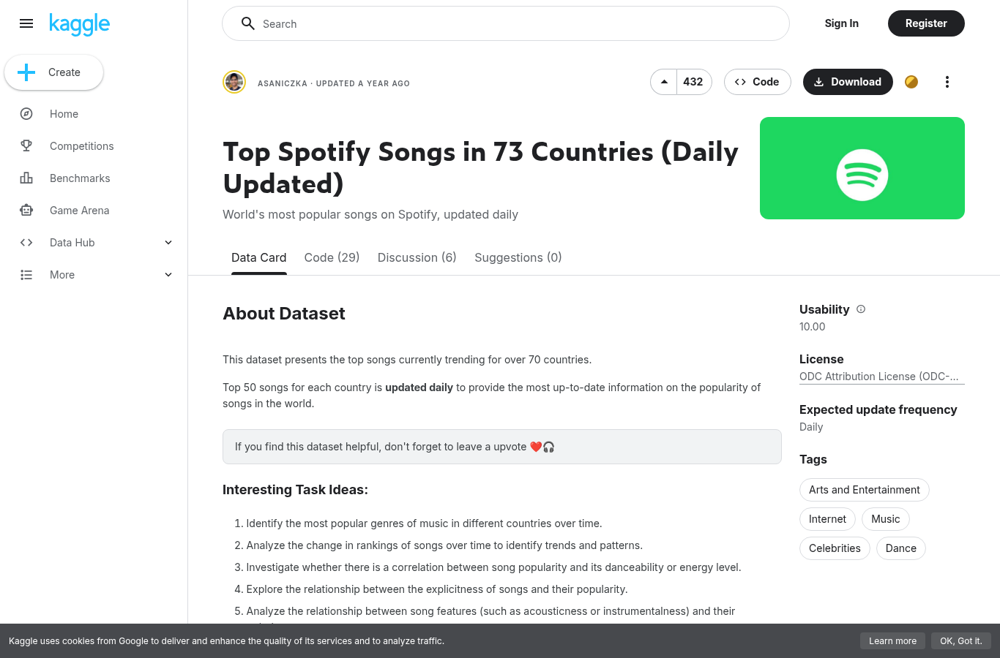
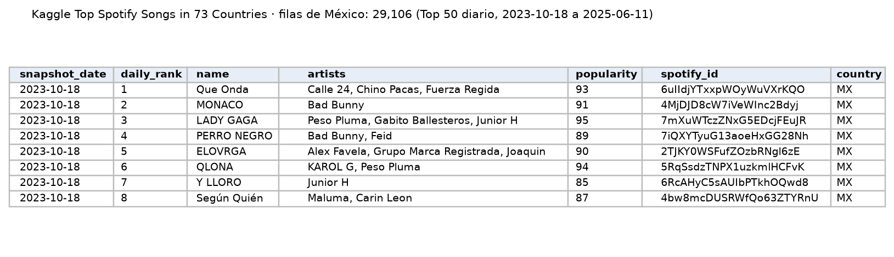

Top 50 diario de Spotify en más de 70 países; da continuidad a la serie de consumo después de 2021, con características de audio de cada canción.

| Campo | Descripción |
|---|---|
| **Nombre y dueño** | *Top Spotify Songs in 73 Countries (Daily Updated)*, publicado en Kaggle (plataforma de datasets de Google) por el usuario asaniczka. |
| **URL** | <https://www.kaggle.com/datasets/asaniczka/top-spotify-songs-in-73-countries-daily-updated> |
| **Acceso** | Descarga con cuenta de Kaggle (`universal_top_spotify_songs.csv`). |
| **Formato y tamaño** | CSV, 498 MB, 2,110,316 filas, 25 columnas (`spotify_id, name, artists, daily_rank, country, snapshot_date, popularity`, características de audio, entre otras). |
| **Grano** | Una fila por canción, país y día (Top 50). |
| **Cobertura** | México: 18 de octubre de 2023 a 11 de junio de 2025, diario. La última actualización es de junio de 2025 aunque el título dice "Daily Updated". |
| **Información de México** | La columna `country` incluye `MX`: 29,106 filas, 582 fechas y 495 canciones distintas. |
| **Licencia y restricciones** | ODC Attribution License (ODC-By). |
| **Llaves de integración** | `spotify_id`: ID de canción de Spotify, el mismo que en Kworb y en la columna `url` de Kaggle *Spotify Charts* (F5). `snapshot_date`: se relaciona con el mes de SESNSP. `name` y `artists`: se relacionan con MiSonGyny y LRCLIB. |
| **Preguntas de E0** | P1, P3. |

{width=55% fig-align="center"}

{width=100% fig-align="center"}

## Problemas anticipados para la integración

- Solo incluye las 50 canciones más escuchadas de cada día, frente a las 200 de Kaggle Spotify Charts.
- No incluye el número de reproducciones, solo un índice de popularidad que calcula Spotify.
- No cubre de enero de 2022 a octubre de 2023, y le faltan algunos días dentro de su periodo.
- Su última actualización es de junio de 2025, aunque se describe como actualizado diariamente.

[← Volver a fuentes de datos](../fuentes.qmd)
