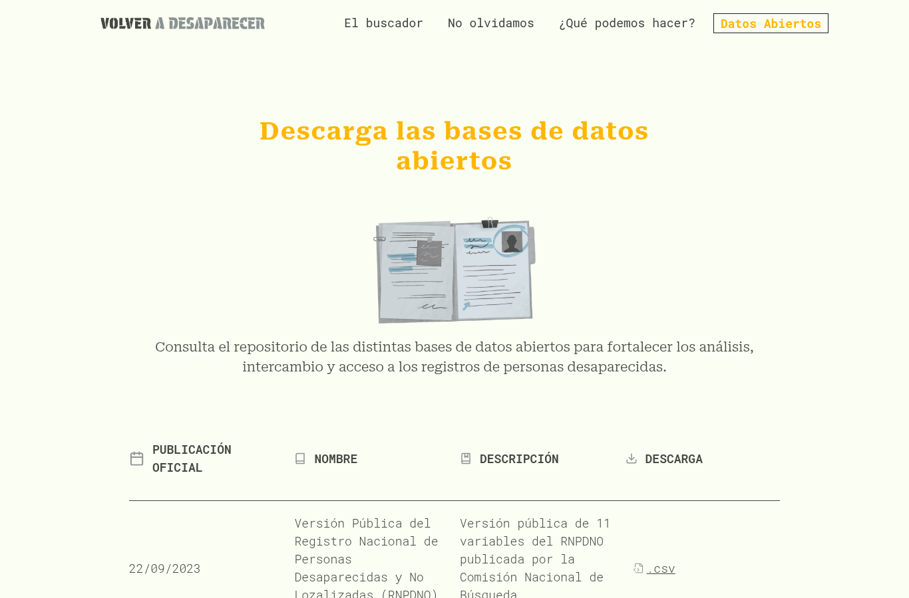
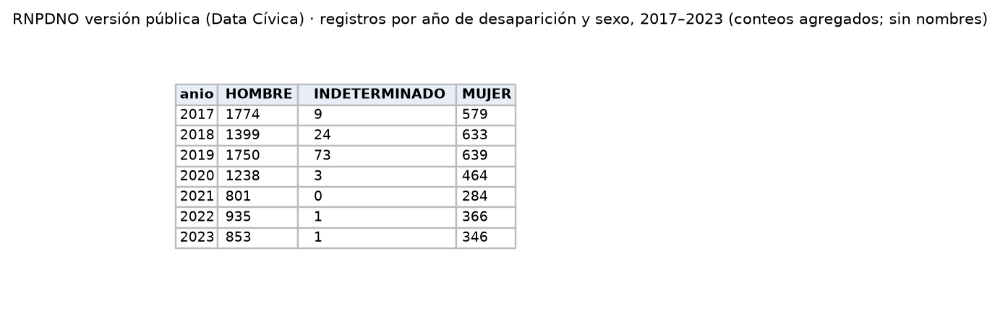
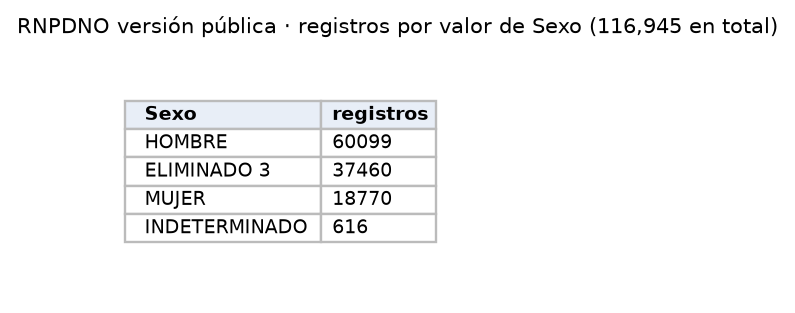

Registro oficial de personas desaparecidas y no localizadas, en la versión pública que reúne y republica Data Cívica. Aporta un indicador de violencia contra las mujeres que no está en el SESNSP: las mujeres desaparecidas.

| Campo | Descripción |
|---|---|
| **Nombre y dueño** | Versión Pública del Registro Nacional de Personas Desaparecidas y No Localizadas (RNPDNO), publicada por la Comisión Nacional de Búsqueda; republicada por Data Cívica (organización de la sociedad civil) en su proyecto *Volver a desaparecer*. |
| **URL** | <https://volveradesaparecer.datacivica.org/datos-abiertos> |
| **Acceso** | Descarga directa de CSV desde Google Drive. Se revisaron la versión pública del RNPDNO (22/09/2023) y la reconstrucción de Data Cívica "registros de 2017 a 2024". |
| **Formato y tamaño** | Versión pública: CSV latin-1, 13 MB, 116,945 filas, 11 columnas (edad, sexo, nacionalidad, fecha y entidad de desaparición, autoridad, nombre). Reconstrucción: CSV, 337 MB, 89,720 filas, 13 columnas, sin sexo. |
| **Grano** | Una fila por reporte de persona desaparecida. |
| **Cobertura** | Versión pública: fechas hasta el 20 de agosto de 2023. La reconstrucción también termina en agosto de 2023 aunque su título dice 2024. |
| **Información de México** | 32 entidades. 18,770 registros de mujeres; de ellos, 3,311 tienen fecha de desaparición entre 2017 y 2023. |
| **Licencia y restricciones** | Información publicada por el Estado; Data Cívica la difunde con fines de memoria y rendición de cuentas. **Contiene nombres de personas:** solo se usan conteos agregados y los nombres no se cargan ni se publican. |
| **Llaves de integración** | Entidad de desaparición: nombre en mayúsculas, que se relaciona con la clave INEGI. Fecha de desaparición: se relaciona con el mes de SESNSP. Sexo y edad: permiten contar solo mujeres. |
| **Preguntas de E0** | P2. |
| **Decisión** | **Aceptada con limitaciones:** cumple el criterio C3. Cumple C1 de forma parcial, porque las preguntas de E0 no mencionan la desaparición de personas, aunque es un indicador de violencia contra las mujeres útil para P2. Cumple C2 de forma parcial, porque termina en 2023 y muchos registros no tienen fecha. Cumple C4 de forma parcial, porque incluye datos personales. |

{width=55% fig-align="center"}

{width=55% fig-align="center"}

{width=40% fig-align="center"}

## Problemas anticipados para la integración

- Una tercera parte de los registros tiene ocultos el sexo y la entidad, y la mayoría no tiene una fecha de desaparición válida.
- Termina en agosto de 2023, por lo que no cubre 2024 ni 2025.
- La entidad está escrita con su nombre y sin acentos, en lugar de usar la clave del INEGI.
- Contiene nombres de personas, por lo que solo pueden usarse conteos agregados.
- La reconstrucción de Data Cívica no indica el sexo de las personas.

[← Volver a fuentes de datos](../fuentes.qmd)
