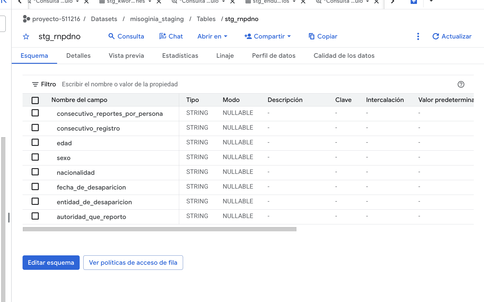
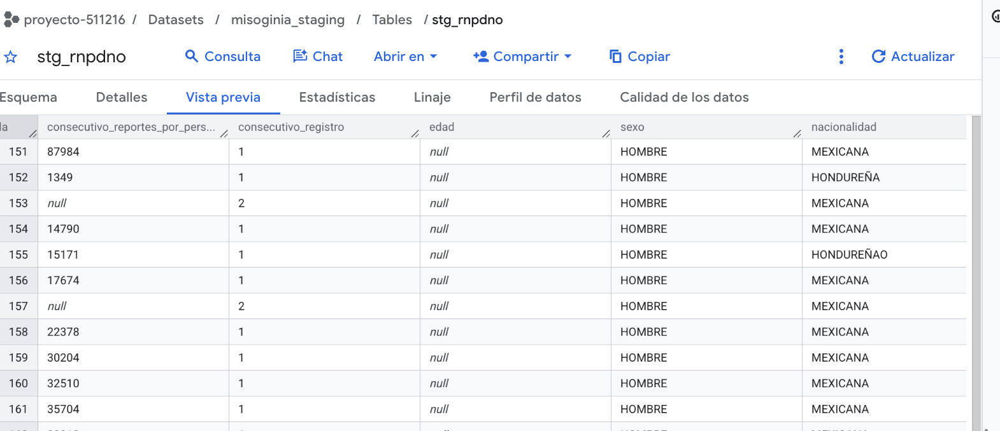

La versión pública del Registro Nacional de Personas Desaparecidas y No Localizadas (RNPDNO) difundida por Data Cívica se incorporó como información complementaria del contexto de violencia en México. Su interpretación requiere diferenciar la fecha de desaparición del corte del registro y evitar equiparar, sin validación, el número de filas al número de personas únicas.

| Campo | Descripción |
|---|---|
| **Responsable** | Comisión Nacional de Búsqueda; versión pública difundida por Data Cívica. |
| **Procedencia** | <https://volveradesaparecer.datacivica.org/datos-abiertos>. Publicación identificada en la página como 22/09/2023; el archivo descargado se denomina `RNPDNO-22-08-2023.csv`. Ambas fechas se conservan diferenciadas. |
| **Formato original** | CSV, 11 columnas: datos demográficos, nominales, fechas, entidad y campos administrativos. |
| **Bronze** | `stg_rnpdno`, ocho columnas `STRING`. El proceso generó 116,945 filas; se requiere una comparación de conteo independiente con el CSV de origen para acreditar integridad de filas. |
| **Minimización de datos** | Se excluyeron `Nombre`, `Primer Apellido` y `Segundo Apellido` antes de cargar a BigQuery por no ser necesarios para los indicadores agregados. No se aplicó eliminación automática de duplicados. |
| **Granularidad** | Registro de la fuente pública. No se presupone que cada fila identifique una persona distinta; los campos `consecutivo_reportes_por_persona` y `consecutivo_registro` no se utilizan como identificadores únicos sin diccionario verificado. |
| **Integración** | Fecha, sexo y entidad permitirán una lectura temporal y geográfica con limitaciones de cobertura, ausencia de datos y posible registro múltiple. |

## Evidencia y consideraciones de calidad

{width=85% fig-align="center"}

{width=85% fig-align="center"}

En la vista previa aparecen edades nulas y posibles inconsistencias en categorías textuales de nacionalidad. Tales valores permanecen en Bronze para no alterar el archivo preparado; se examinarán en Silver, con comprobaciones de codificación, nulidad y granularidad. Los identificadores administrativos tampoco se expondrán en las vistas públicas del DataMart.

El proceso de minimización y exportación se documenta en el bloque C del [`notebook de preparación`](../datos/staging/preparar_staging_colab.ipynb).

[← Volver a fuentes de datos](../fuentes.qmd)
