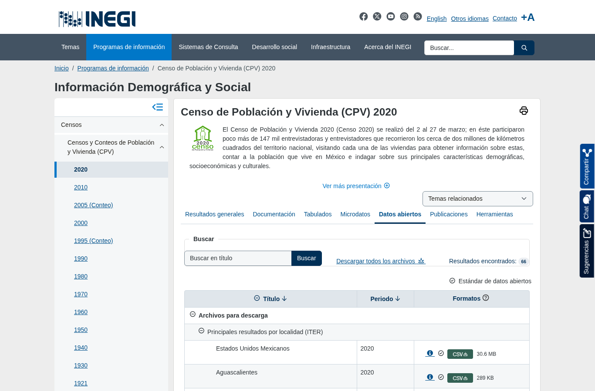
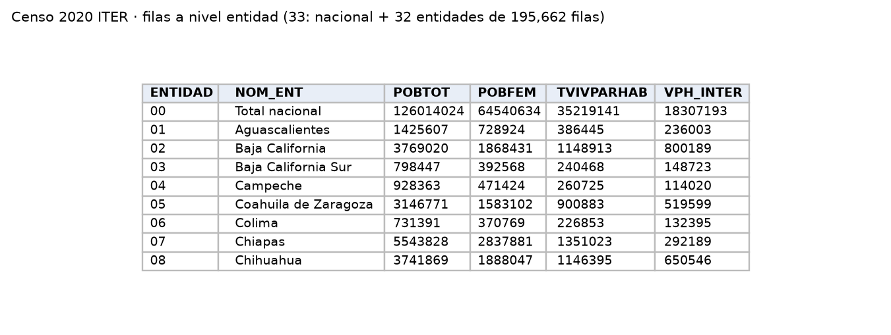

Resultados del Censo de Población y Vivienda 2020 por entidad, municipio y localidad. Aporta población y acceso a internet en las viviendas por entidad, para controlar la correlación de P2 y revisar el supuesto de E0 de que el consumo por streaming representa el consumo real.

| Campo | Descripción |
|---|---|
| **Nombre y dueño** | Censo de Población y Vivienda 2020, Principales resultados por localidad (ITER). Instituto Nacional de Estadística y Geografía. |
| **URL** | <https://www.inegi.org.mx/programas/ccpv/2020/> (pestaña *Datos abiertos*). |
| **Acceso** | Descarga directa del ZIP nacional (`iter_00_cpv2020_csv.zip`, 36.6 MB). |
| **Formato y tamaño** | CSV UTF-8, 150 MB, 195,662 filas; incluye diccionario de datos. |
| **Grano** | Una fila por localidad, con filas de total por municipio, por entidad y nacional. |
| **Cobertura** | Un solo levantamiento: 2020. |
| **Información de México** | 33 filas a nivel entidad (nacional + 32 entidades), con `POBTOT`, `POBFEM`, `VPH_INTER` (viviendas con internet) y `TVIVPARHAB`. |
| **Licencia y restricciones** | Términos de libre uso de la información del INEGI. |
| **Llaves de integración** | `ENTIDAD`: clave INEGI de la entidad, la misma de SESNSP, ENDIREH y CONAPO. Año del censo: 2020. |
| **Preguntas de E0** | P2. |

{width=55% fig-align="center"}

{width=85% fig-align="center"}

## Problemas anticipados para la integración

- Solo corresponde a 2020, por lo que no permite ver cambios en el tiempo.
- Los totales por entidad están en el mismo archivo que los datos de cada localidad.
- La clave de entidad tiene un formato distinto al que usan el SESNSP y CONAPO.

[← Volver a fuentes de datos](../fuentes.qmd)
