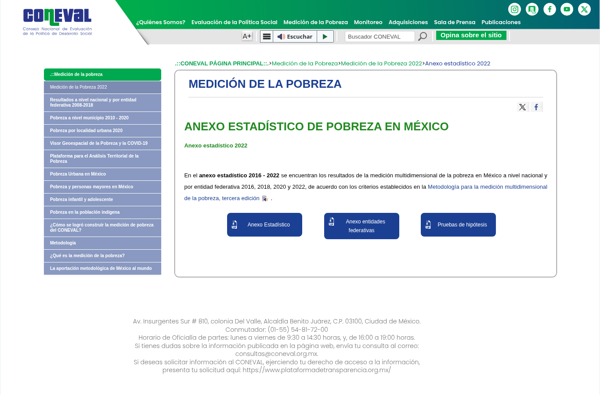
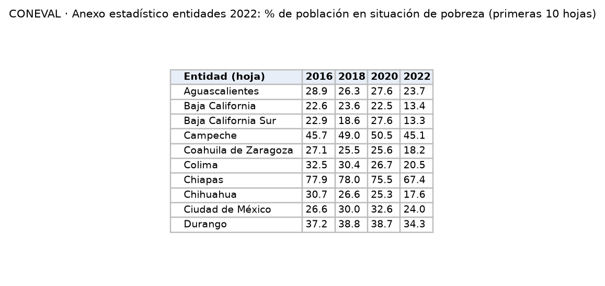

Porcentaje y número de personas en pobreza por entidad federativa. Se usa como variable de control socioeconómica en la correlación de P2.

| Campo | Descripción |
|---|---|
| **Nombre y dueño** | Medición multidimensional de la pobreza, *Anexo estadístico entidades 2022*. Consejo Nacional de Evaluación de la Política de Desarrollo Social (CONEVAL). |
| **URL** | <https://www.coneval.org.mx/Medicion/MP/Paginas/AE_pobreza_2022.aspx> |
| **Acceso** | Descarga directa del ZIP `AE_estatal_2022.zip`. |
| **Formato y tamaño** | Libro de Excel (318 KB) con 34 hojas: contenido, nacional y una hoja por entidad, en formato de reporte. |
| **Grano** | Un valor por indicador de pobreza, entidad y año. |
| **Cobertura** | 2016, 2018, 2020 y 2022 (bienal). |
| **Información de México** | 32 entidades. Ejemplo: población en pobreza en Chiapas 67.4 % y en Aguascalientes 23.7 % en 2022. |
| **Licencia y restricciones** | Información pública del CONEVAL; se cita la fuente. |
| **Llaves de integración** | Nombre de la entidad (una hoja por entidad), que se relaciona con la clave INEGI. Año: se relaciona con el año de las demás fuentes. |
| **Preguntas de E0** | P2. |

{width=55% fig-align="center"}

{width=60% fig-align="center"}

## Problemas anticipados para la integración

- Los datos están en un libro de Excel con formato de reporte, con una hoja por entidad.
- Las entidades se identifican por su nombre, sin clave numérica.
- La medición se hace cada dos años, por lo que 2017, 2019 y 2021 no tienen datos.

[← Volver a fuentes de datos](../fuentes.qmd)
