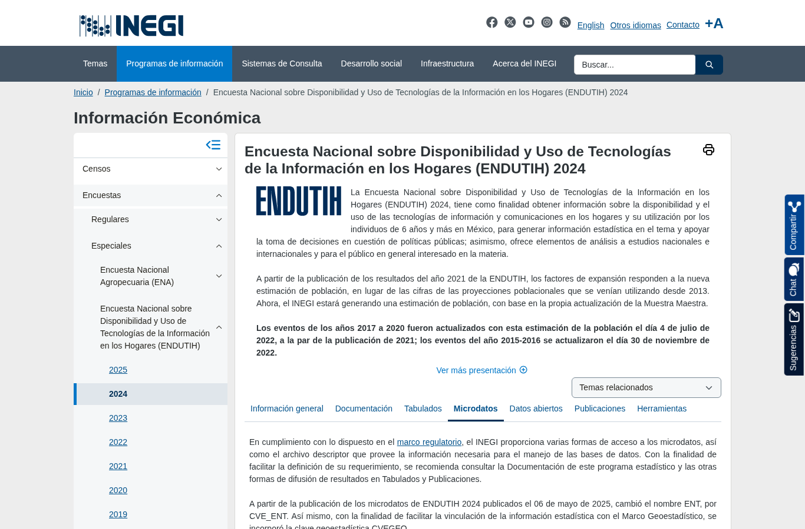
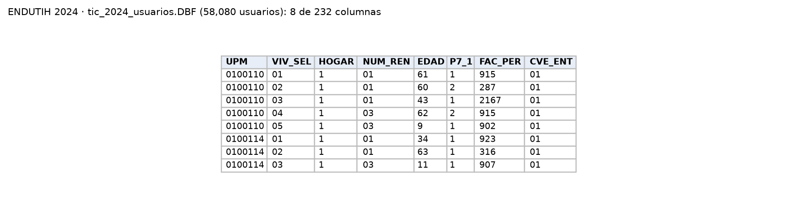

Encuesta sobre disponibilidad y uso de internet y otras tecnologías en los hogares. Aporta el porcentaje de usuarios de internet por entidad, para revisar el supuesto de E0 de que el consumo por streaming representa el consumo real y como control de P2.

| Campo | Descripción |
|---|---|
| **Nombre y dueño** | Encuesta Nacional sobre Disponibilidad y Uso de Tecnologías de la Información en los Hogares (ENDUTIH) 2024. Instituto Nacional de Estadística y Geografía. |
| **URL** | <https://www.inegi.org.mx/programas/endutih/2024/> (pestaña *Microdatos*). |
| **Acceso** | Descarga directa del ZIP de microdatos en DBF (`endutih2024_bd_dbf.zip`, 8.8 MB); la versión CSV aparece como pendiente. |
| **Formato y tamaño** | 5 tablas DBF: viviendas (57,225 filas), hogares, residentes (194,033), usuarios (58,080, 232 columnas) y usuarios 2. |
| **Grano** | Una fila por vivienda, hogar, residente o usuario según la tabla; se expande con su factor (`FAC_PER` para usuarios). |
| **Cobertura** | Levantamiento anual; se verificó 2024. |
| **Información de México** | `CVE_ENT` con las 32 entidades en las 5 tablas. |
| **Licencia y restricciones** | Términos de libre uso de la información del INEGI. Microdatos anonimizados. |
| **Llaves de integración** | `CVE_ENT`: clave INEGI de la entidad (desde 2024 sustituye a `ENT`). Año de levantamiento. |
| **Preguntas de E0** | P1, P2. |

{width=55% fig-align="center"}

{width=85% fig-align="center"}

## Problemas anticipados para la integración

- Los microdatos solo están disponibles en un formato distinto al del resto de las fuentes.
- Es una muestra: sus resultados representan a la población solo cuando se usan los factores de expansión.
- El nombre de la clave de entidad cambió en la edición 2024.

[← Volver a fuentes de datos](../fuentes.qmd)
