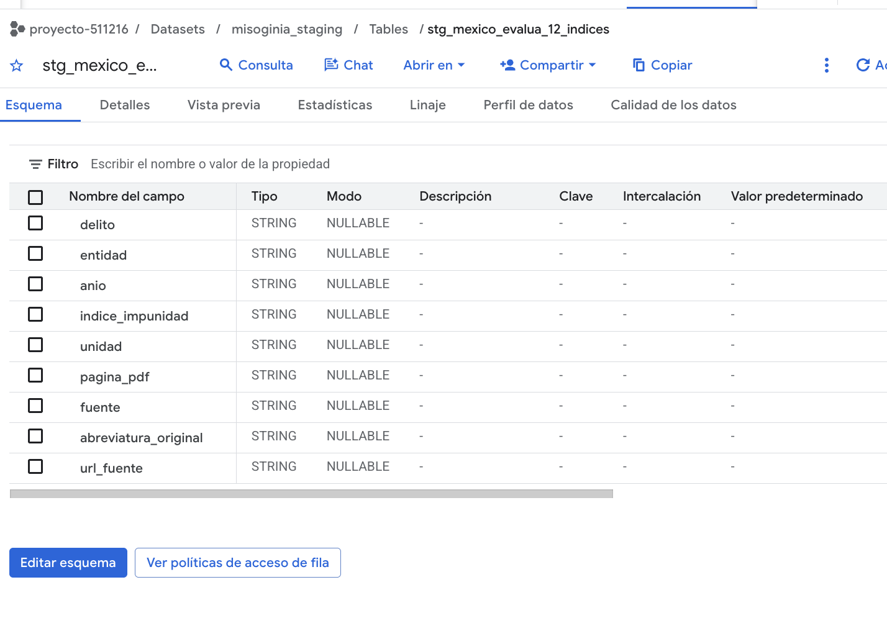
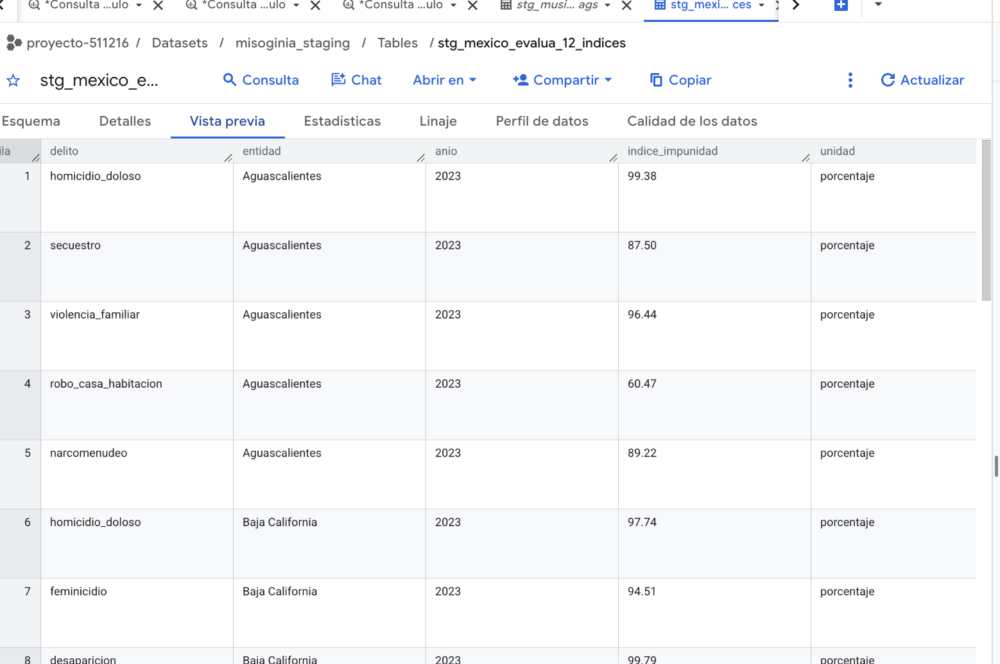

La publicación *Hallazgos 2023: Seguimiento y evaluación de la justicia penal en México* permitió construir una tabla de **doce índices de impunidad por delito**, con cobertura estatal variable. Se conserva el indicador general del fuero común como contexto separado; la tabla cargada se enfoca en los doce índices específicos presentados en las gráficas del capítulo 2.

| Campo | Descripción |
|---|---|
| **Responsable** | México Evalúa. |
| **Documento de origen** | <https://www.mexicoevalua.org/wp-content/uploads/2024/10/HALLAZGOS2023.pdf>, capítulo 2, índices específicos. |
| **Formato original** | Gráficas en PDF; el reporte no presenta un CSV tabular único para esta selección. |
| **Tabla creada** | `stg_mexico_evalua_12_indices`, con nueve campos `STRING`: `delito`, `entidad`, `anio`, `indice_impunidad`, `unidad`, `pagina_pdf`, `fuente`, `abreviatura_original` y `url_fuente`. |
| **Cobertura del CSV** | Año 2023, 12 delitos, 314 filas que incluyen 12 valores nacionales. Cada delito tiene distinto número de entidades. |
| **Grano** | Una barra publicada por delito y entidad, o valor nacional. |
| **Trazabilidad** | Se retiene la abreviatura de entidad que aparece en la figura y el número de página del PDF, además de la referencia original. |
| **Limitaciones** | Las entidades que no aparecen en una gráfica no se sustituyen por ceros ni por promedios. Los índices de impunidad son indicadores de respuesta institucional; no son tasas de victimización ni medidas del consumo de música. |

## Alcance de la extracción

| Índice de impunidad | Filas del CSV |
|---|---:|
| Homicidio doloso | 30 |
| Feminicidio | 24 |
| Desaparición | 21 |
| Secuestro | 26 |
| Extorsión | 26 |
| Violación | 26 |
| Violencia familiar | 29 |
| Abuso sexual | 28 |
| Despojo | 27 |
| Fraude | 28 |
| Robo a casa habitación | 21 |
| Narcomenudeo | 28 |
| **Total** | **314** |

El extractor usa el texto y sus coordenadas dentro del PDF para asociar las abreviaturas de entidad con los porcentajes; comprueba las doce series, rangos de porcentaje, unicidad de la combinación delito–entidad y la existencia del valor nacional. Además de estas verificaciones automáticas, **los 314 registros extraídos fueron cotejados manualmente, entrada por entrada, contra las gráficas originales del informe**, comprobando la correspondencia entre delito, entidad y porcentaje publicado. Este cotejo complementa las validaciones estructurales y permite identificar las entidades que la fuente excluye por falta de información o inconsistencias.

{width=85% fig-align="center"}

{width=85% fig-align="center"}

Se entregan el [`extractor reproducible`](../datos/staging/extraer_hallazgos_2023_completo.py), el [`CSV de 12 índices`](../datos/staging/stg_mexico_evalua_12_indices.csv) y el bloque J del [`notebook de staging`](../datos/staging/preparar_staging_colab.ipynb).

## Utilidad analítica

Feminicidio, violencia familiar, violación, abuso sexual y desaparición pueden aportar información contextual sobre la respuesta institucional asociada a formas de violencia de interés para el proyecto. El resto de delitos permite contrastar la especificidad de los resultados. Como se trata de una observación de 2023, no se extrapolará de forma automática a toda la serie histórica del consumo musical y la incidencia delictiva.

[← Volver a fuentes de datos](../fuentes.qmd)
