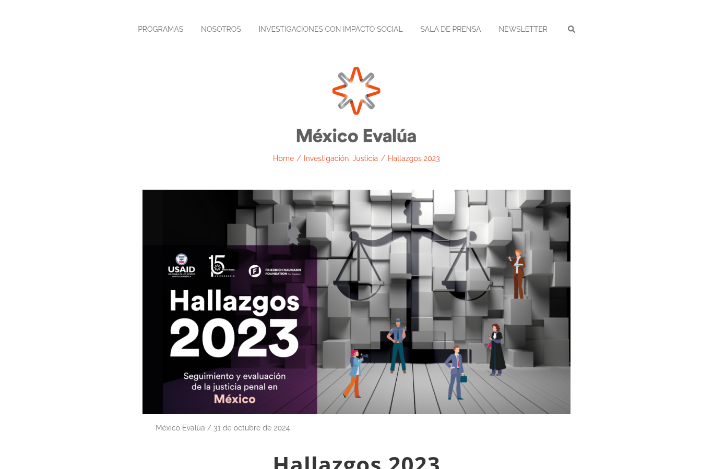
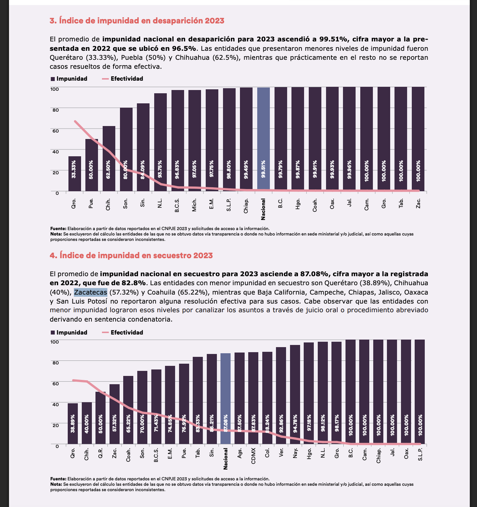

Índice que mide la proporción de casos penales sin resolución por entidad. Se usa como control del subregistro en P2: donde la impunidad es mayor, se espera que se denuncie menos.

| Campo | Descripción |
|---|---|
| **Nombre y dueño** | *Hallazgos 2023: Seguimiento y evaluación de la justicia penal en México*. México Evalúa, centro de pensamiento y análisis de políticas públicas. |
| **URL** | <https://www.mexicoevalua.org/hallazgos-2023/> |
| **Acceso** | Descarga directa del reporte en PDF (207 páginas, 21 MB); no hay base de datos tabular. |
| **Formato y tamaño** | PDF con tablas y gráficas por entidad. |
| **Grano** | Un valor del índice por entidad y año. |
| **Cobertura** | 2023 (fuero común). El propio reporte indica que 2023 no es comparable con 2019–2022. |
| **Información de México** | Promedio nacional del fuero común en 2023: 93.63 %. El cálculo excluye seis entidades por información inconsistente o incompleta. |
| **Licencia y restricciones** | Reporte público; sin licencia de datos declarada. Se cita la fuente. |
| **Llaves de integración** | Nombre de la entidad, que se relaciona con la clave INEGI. Año. |
| **Preguntas de E0** | P2. |
| **Decisión** | **Aceptada con limitaciones:** cumple los criterios C1 y C3. Cumple C2 de forma parcial, porque solo hay un año comparable y faltan seis entidades. Cumple C4 de forma parcial, porque no tiene una licencia de datos declarada y los valores están dentro de un reporte en PDF. |

{width=55% fig-align="center"}

{width=75% fig-align="center"}

## Problemas anticipados para la integración

- Los valores están dentro de un reporte en PDF, no en una tabla descargable.
- Seis entidades no tienen índice en 2023.
- El índice de 2023 no es comparable con los de años anteriores por un cambio de metodología.

[← Volver a fuentes de datos](../fuentes.qmd)
