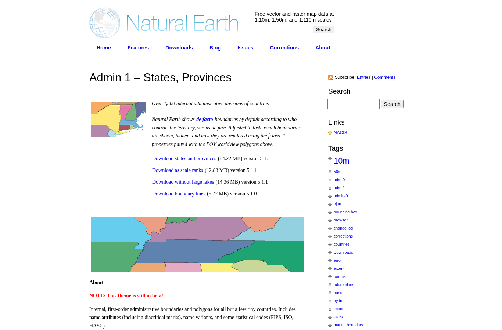
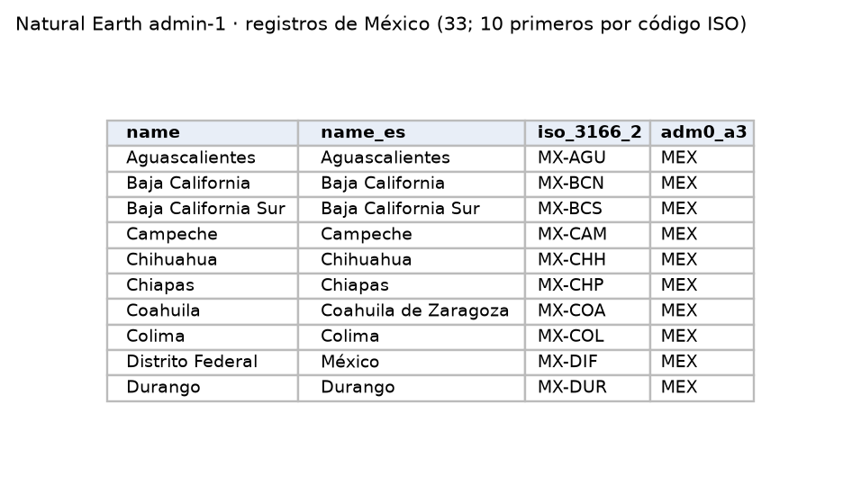

Límites geográficos de los estados para dibujar mapas por entidad de los resultados de P1 y P2.

| Campo | Descripción |
|---|---|
| **Nombre y dueño** | *Admin 1 – States, Provinces*, escala 1:10m. Natural Earth, proyecto colaborativo de cartografía de dominio público apoyado por la North American Cartographic Information Society (NACIS). |
| **URL** | <https://www.naturalearthdata.com/downloads/10m-cultural-vectors/10m-admin-1-states-provinces/> |
| **Acceso** | Descarga directa del ZIP (14.9 MB). |
| **Formato y tamaño** | Shapefile (geometrías + tabla DBF con 121 atributos); 4,596 divisiones de todo el mundo. |
| **Grano** | Una fila por división administrativa de primer nivel (estado). |
| **Cobertura** | Límites vigentes (versión 5.1.1); no es serie de tiempo. |
| **Información de México** | 33 registros con `adm0_a3 = MEX`: los 32 estados y un registro sin nombre (`MX-X01~`). |
| **Licencia y restricciones** | Dominio público. |
| **Llaves de integración** | `iso_3166_2`: código ISO del estado (`MX-SON`, `MX-JAL`, …), el mismo que usa Google Trends; se relaciona con la clave INEGI. `name`: nombre del estado. |
| **Preguntas de E0** | P1, P2. |

{width=55% fig-align="center"}

{width=70% fig-align="center"}

## Problemas anticipados para la integración

- La Ciudad de México aparece con su nombre y su código anteriores, como Distrito Federal, y su nombre en español está registrado de forma incorrecta.
- Incluye un registro adicional sin nombre dentro de México.
- No incluye la clave del INEGI, solo el código ISO y el nombre de cada estado.

[← Volver a fuentes de datos](../fuentes.qmd)
