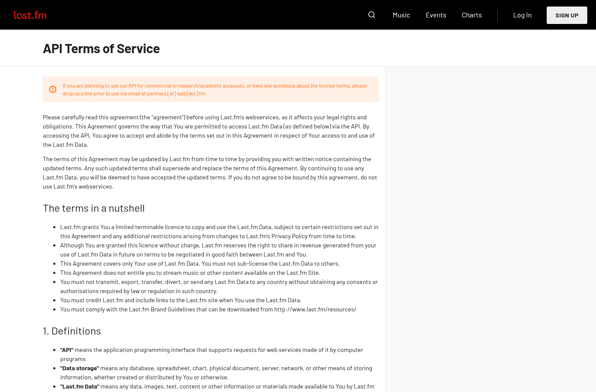

Servicio de música con etiquetas de género asignadas por sus usuarios. Se acepta como complemento de MusicBrainz para los artistas que no tengan género registrado ahí.

| Campo | Descripción |
|---|---|
| **Nombre y dueño** | Last.fm Ltd., servicio de música en línea con perfiles de escucha y etiquetas de sus usuarios. |
| **URL** | <https://www.last.fm/api> |
| **Acceso** | API REST que requiere llave (`api_key`); sin ella responde "Invalid parameters" (error 6). |
| **Formato y tamaño** | JSON. |
| **Grano** | Una fila por artista y etiqueta. |
| **Cobertura** | Global, sin fecha. |
| **Información de México** | No se pudo abrir sin llave. |
| **Licencia y restricciones** | Términos de la API: uso solo no comercial; para uso académico o de investigación piden contactarlos antes de usarla. |
| **Llaves de integración** | Nombre del artista. |
| **Decisión** | **Aceptada con limitaciones:** cumple los criterios C1 y C3. Cumple C4 solo de forma condicionada, porque sus términos piden solicitar autorización antes de usar la API con fines académicos; se usará únicamente cuando Last.fm la otorgue. C2 se revisará con la autorización, ya que sin llave no fue posible consultar sus datos. |

{width=55% fig-align="center"}

## Problemas anticipados para la integración

- Requiere una llave de acceso y autorización previa de Last.fm para uso académico.
- Las etiquetas las asignan los usuarios y no siguen un catálogo fijo de géneros.
- Los nombres de los artistas pueden escribirse distinto que en los charts y en MusicBrainz.

[← Volver a fuentes de datos](../fuentes.qmd)
